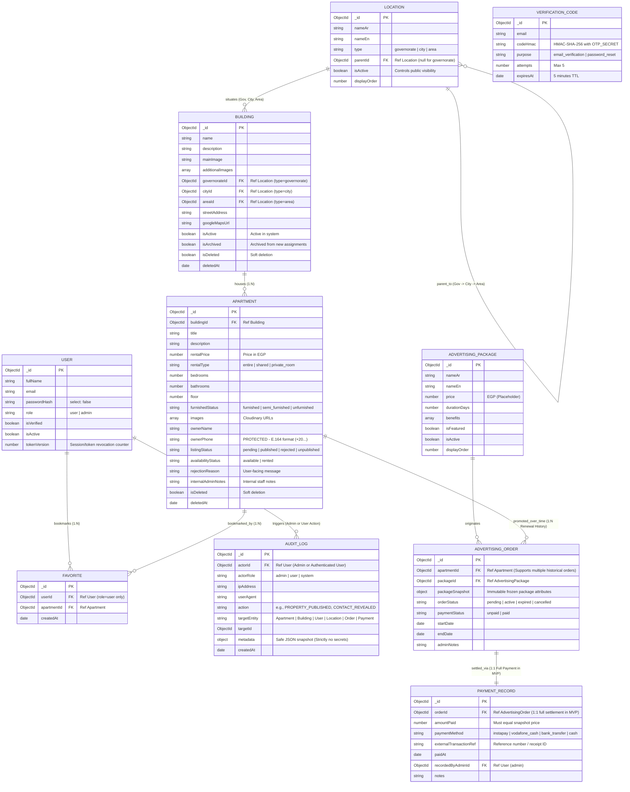

# SUKNA (سُكنا) — Database Architecture & MongoDB Schema Specification

> **Document Version:** 2.0.0  
> **Target Database Engine:** MongoDB 6.0+ / 7.0+ with Mongoose ODM  
> **Status:** Architectural Planning Baseline (Refined Business Logic & Schemas)

---

## 1. High-Level Entity Relationship Diagram (ERD)

---

## 2. Core Business Logic & Invariants

### 2.1. Dynamic Location Hierarchy & Integrity Rules
The platform models a strict 3-tier geographic structure:
$$\text{Governorate (محافظة)} \longrightarrow \text{City / District (مدينة / مركز)} \longrightarrow \text{Area / Neighborhood (حي / منطقة)}$$

- **Building Location References:**  
  Each Building directly stores `governorateId`, `cityId`, and `areaId` as indexed foreign keys.
- **Backend Hierarchy Validation:**  
  When creating or updating a Building, the backend validation middleware must strictly verify:
  1. `governorateId` exists, is of `type: 'governorate'`, and is active.
  2. `cityId` exists, is of `type: 'city'`, has `parentId === governorateId`, and is active.
  3. `areaId` exists, is of `type: 'area'`, has `parentId === cityId`, and is active.
  *Inconsistent or mismatched combinations (e.g., an area in Qena assigned to a city in Minya) are rejected with HTTP 400.*
- **Dynamic Administrative Management:**  
  Locations are fully managed via the Admin Dashboard. Adding a new governorate (e.g., Assiut, Luxor) or city requires zero code changes or deployments.

### 2.2. Separation of Statuses & Lifecycle Rules
To prevent business logic tangling, four independent operational statuses are maintained:

```mermaid
flowchart TD
    subgraph BuildingLifecycle["1. Building Operational State"]
        B1["isActive: true / false"] --> B2["isArchived: true / false"]
    end

    subgraph ListingLifecycle["2. Apartment Listing Workflow"]
        L_Pending["pending (Draft / Awaiting Review)"]
        L_Pub["published (Live on Public Website)"]
        L_Rej["rejected (Declined by Admin)"]
        L_Unpub["unpublished (Suspended by Admin)"]
        L_Pending --> L_Pub
        L_Pending --> L_Rej
        L_Pub --> L_Unpub
        L_Unpub --> L_Pub
    end

    subgraph AvailabilityLifecycle["3. Apartment Physical Vacancy"]
        AV_Avail["available (Accepting Inquiries)"]
        AV_Rented["rented (Occupied / Withdrawn from Search)"]
        AV_Avail <--> AV_Rented
    end

    subgraph MonetizationLifecycle["4. Advertising & Payment State"]
        P_Unpaid["Order: pending | Payment: unpaid"]
        P_Paid["Order: active | Payment: paid"]
        P_Exp["Order: expired | Payment: paid"]
        P_Unpaid -->|Admin Records Full Payment| P_Paid
        P_Paid -->|Time Duration Reached| P_Exp
    end
```

### 2.3. Public Listing Visibility Invariants
An apartment appears in public discovery search results **if and only if all of the following conditions are met simultaneously**:
1. `apartment.isDeleted === false` (Not soft-deleted).
2. `apartment.listingStatus === 'published'`.
3. `apartment.availabilityStatus === 'available'` (Rented apartments are excluded from regular active search queries).
4. `building.isDeleted === false` and `building.isActive === true` and `building.isArchived === false`.
5. Related `governorate`, `city`, and `area` all have `isActive === true`.

*Note:* If a building is archived, or if a city tier is deactivated, its existing historical orders, payment audits, and statistics remain intact, but associated apartments immediately cease appearing in public search results.

### 2.4. Soft Deletion vs. Archiving Behavior
- **Soft Deletion (`isDeleted: true`, `deletedAt: Date`):**
  - Applied to Buildings and Apartments when an admin deletes a listing.
  - Documents remain in MongoDB with `isDeleted: true`.
  - **Zero Cascade Deletions:** Deleting an apartment or building **never cascades** to delete `advertising_orders`, `payment_records`, `audit_logs`, or past accounting logs.
  - Foreign key references continue to resolve gracefully in historical reports.
- **Archiving (`isArchived: true`):**
  - Applied to a Building when it is permanently full or temporarily withdrawn. Existing apartment history is preserved.
  - Prevents adding new apartments to this building while keeping existing records accessible to administrators.

### 2.5. Advertising Orders, Renewals & Payment Invariants
- **Multiple Orders Per Property (Renewal History):**  
  An Apartment is **not** limited to one lifetime Advertising Order. Over months and years, landlords renew their placements. The schema supports a $1:N$ relationship between `Apartment` and `AdvertisingOrder`.
- **Order Renewal Process:**  
  When an advertisement expires and the landlord renews via WhatsApp, the admin generates a **new** `AdvertisingOrder` with a new frozen package snapshot. Past expired orders remain permanently visible in the apartment's monetization history.
- **Single Full Payment per Order in MVP:**  
  Each advertising order is settled via a single full payment (`1:1`). There are no partial installments, deposits, or split payments in the MVP.
- **Order State Transitions:**
  - Upon order creation: `orderStatus = 'pending'`, `paymentStatus = 'unpaid'`, `startDate = null`, `endDate = null`.
  - Upon admin manual payment confirmation:
    1. A `PaymentRecord` is created verifying full receipt of the exact package snapshot price.
    2. `orderStatus` transitions to `'active'`.
    3. `paymentStatus` transitions to `'paid'`.
    4. `startDate` is set to the settlement timestamp (`Date.now()`).
    5. `endDate` is set to `startDate + (packageSnapshot.durationDays * 24 * 60 * 60 * 1000)`.
- **Immutable Package Snapshots:**  
  When an order is created, the system stores an immutable subdocument `packageSnapshot` containing:
  `{ nameAr, nameEn, price, durationDays, benefits }`.
  Future price edits or tier changes in `advertising_packages` **never mutate past order snapshots**.
- **Pricing Disclaimer:**  
  All example package prices in documentation and database seeds are strictly **placeholders** awaiting commercial approval.

---

## 3. Collection Schemas & Data Dictionaries

### 3.1. `users` Collection
Stores student/renter accounts and seeded administrators.

| Field Name | Type | Required | Default | Validation & Constraints | Description |
| :--- | :--- | :---: | :--- | :--- | :--- |
| `_id` | `ObjectId` | Yes | Auto | Unique identifier | Primary Key |
| `fullName` | `String` | Yes | — | Min 3, Max 100 chars, trimmed | User's full display name |
| `email` | `String` | Yes | — | Unique, lowercase, trimmed, valid email regex | Login identifier |
| `passwordHash` | `String` | Yes | — | `select: false` (Excluded from default queries) | 60-char bcrypt hash ($\ge 12$ rounds) |
| `role` | `String` | Yes | `'user'` | Enum: `['user', 'admin']` | RBAC role |
| `isVerified` | `Boolean` | Yes | `false` | Boolean | Email OTP verification state |
| `isActive` | `Boolean` | Yes | `true` | Boolean | Account active/suspended flag |
| `tokenVersion` | `Number` | Yes | `0` | Integer $\ge 0$ | Incremented to invalidate all active JWTs upon logout/security reset |
| `createdAt` | `Date` | Yes | Auto | Timestamps = true | Registration timestamp |
| `updatedAt` | `Date` | Yes | Auto | Timestamps = true | Last update timestamp |

**Indexes:**
- `{ email: 1 }` (**Unique Index**)
- `{ role: 1, isVerified: 1, isActive: 1 }` (Admin user management index)

---

### 3.2. `verification_codes` Collection
Manages short-lived, HMAC-secured 6-digit OTP codes for email verification and password resets.

| Field Name | Type | Required | Default | Validation & Constraints | Description |
| :--- | :--- | :---: | :--- | :--- | :--- |
| `_id` | `ObjectId` | Yes | Auto | Unique identifier | Primary Key |
| `email` | `String` | Yes | — | Lowercase, trimmed, valid email regex | Target email address |
| `codeHmac` | `String` | Yes | — | 64-character hex digest | HMAC-SHA-256 of 6-digit code with `OTP_SECRET` |
| `purpose` | `String` | Yes | — | Enum: `['email_verification', 'password_reset']` | Purpose separation |
| `attempts` | `Number` | Yes | `0` | Min 0, Max 5 | Failed attempt counter |
| `expiresAt` | `Date` | Yes | — | Exactly 5 minutes from creation | Code expiration deadline |
| `createdAt` | `Date` | Yes | Auto | Timestamps = true | Creation timestamp |

**Indexes:**
- `{ email: 1, purpose: 1 }` (Query lookup index)
- `{ expiresAt: 1 }` with `{ expireAfterSeconds: 0 }` (**TTL Auto-Deletion Index**)

---

### 3.3. `locations` Collection (Dynamic Geographic Coverage)
Implements an Adjacency List pattern representing the 3-tier hierarchy: `governorate` $\to$ `city` $\to$ `area`.

| Field Name | Type | Required | Default | Validation & Constraints | Description |
| :--- | :--- | :---: | :--- | :--- | :--- |
| `_id` | `ObjectId` | Yes | Auto | Unique identifier | Primary Key |
| `nameAr` | `String` | Yes | — | Min 2, Max 100 chars, trimmed | Arabic name (e.g., 'قنا') |
| `nameEn` | `String` | Yes | — | Min 2, Max 100 chars, trimmed | English name (e.g., 'Qena') |
| `type` | `String` | Yes | — | Enum: `['governorate', 'city', 'area']` | Hierarchical level |
| `parentId` | `ObjectId` | Optional | `null` | Ref: `'Location'`. Required if type is `city` or `area` | Parent tier pointer |
| `isActive` | `Boolean` | Yes | `true` | Boolean | Public search visibility toggle |
| `displayOrder` | `Number` | Yes | `0` | Integer | Sorting priority in UI dropdowns |
| `createdAt` | `Date` | Yes | Auto | Timestamps = true | Creation timestamp |

**Indexes:**
- `{ parentId: 1, isActive: 1 }` (Tree retrieval)
- `{ type: 1, isActive: 1, displayOrder: 1 }` (Tier retrieval)

---

### 3.4. `buildings` Collection
Represents a physical building structure housing one or more residential apartments.

| Field Name | Type | Required | Default | Validation & Constraints | Description |
| :--- | :--- | :---: | :--- | :--- | :--- |
| `_id` | `ObjectId` | Yes | Auto | Unique identifier | Primary Key |
| `name` | `String` | Yes | — | Min 3, Max 150 chars, trimmed | Building name (e.g., 'برج الصفا 3') |
| `description` | `String` | Optional | `""` | Max 1000 chars | General building description |
| `mainImage` | `String` | Yes | — | Valid Cloudinary URL | Primary building exterior photo |
| `mainImagePublicId` | `String` | Yes | — | String | Cloudinary asset public ID (for safe deletion) |
| `additionalImages` | `[String]` | Optional | `[]` | Array of Cloudinary URLs | Entrances/corridor gallery |
| `additionalImagePublicIds` | `[String]` | Optional | `[]` | Array of strings | Asset public IDs for cleanup |
| `governorateId` | `ObjectId` | Yes | — | Ref: `'Location'` (type: governorate) | Primary governorate reference |
| `cityId` | `ObjectId` | Yes | — | Ref: `'Location'` (type: city) | City reference |
| `areaId` | `ObjectId` | Yes | — | Ref: `'Location'` (type: area) | Specific neighborhood reference |
| `streetAddress` | `String` | Yes | — | Min 5, Max 250 chars | Physical street description |
| `googleMapsUrl` | `String` | Yes | — | Regex: `^https:\/\/(www\.)?(google\.com\/maps|maps\.app\.goo\.gl)\/.*` | Direct Google Maps deep link |
| `isActive` | `Boolean` | Yes | `true` | Boolean | General active flag |
| `isArchived` | `Boolean` | Yes | `false` | Boolean | Archived flag (no new units) |
| `isDeleted` | `Boolean` | Yes | `false` | Boolean | Soft deletion flag |
| `deletedAt` | `Date` | Optional | `null` | Timestamp | Soft deletion timestamp |
| `createdAt` | `Date` | Yes | Auto | Timestamps = true | Creation timestamp |
| `updatedAt` | `Date` | Yes | Auto | Timestamps = true | Last update timestamp |

**Indexes:**
- `{ governorateId: 1, cityId: 1, areaId: 1, isDeleted: 1, isActive: 1 }` (Geographic search index)
- `{ isDeleted: 1, isArchived: 1, isActive: 1 }` (Public availability index)
- `{ createdAt: -1 }` (Newest buildings)

---

### 3.5. `apartments` Collection
Represents individual rentable residential apartments or units.

| Field Name | Type | Required | Default | Validation & Constraints | Description |
| :--- | :--- | :---: | :--- | :--- | :--- |
| `_id` | `ObjectId` | Yes | Auto | Unique identifier | Primary Key |
| `buildingId` | `ObjectId` | Yes | — | Ref: `'Building'` | Parent building reference |
| `title` | `String` | Yes | — | Min 5, Max 150 chars, trimmed | Public listing title |
| `description` | `String` | Yes | — | Min 20, Max 3000 chars | Comprehensive property overview |
| `rentalPrice` | `Number` | Yes | — | Min 100, Max 500,000 (EGP) | Monthly rent amount |
| `rentalType` | `String` | Yes | `'entire'` | Enum: `['entire', 'shared', 'private_room']` | Rental accommodation mode |
| `bedrooms` | `Number` | Yes | — | Min 1, Max 15, integer | Number of bedrooms |
| `bathrooms` | `Number` | Yes | — | Min 1, Max 10, integer | Number of bathrooms |
| `floor` | `Number` | Yes | — | Min -2 (Basement), Max 50 | Floor number |
| `furnishedStatus` | `String` | Yes | `'unfurnished'` | Enum: `['furnished', 'semi_furnished', 'unfurnished']` | Furniture condition |
| `images` | `[String]` | Yes | — | Array of valid Cloudinary URLs, Min 1, Max 15 | Interior photograph gallery |
| `imagePublicIds` | `[String]` | Yes | — | Array of Cloudinary asset IDs | Storage IDs for orphan cleanup |
| `ownerName` | `String` | Yes | — | Min 2, Max 100 chars | Landlord name |
| `ownerPhone` | `String` | Yes | — | **Protected:** E.164 format (e.g. `+201012345678`) | Landlord direct contact number |
| `listingStatus` | `String` | Yes | `'pending'` | Enum: `['pending', 'published', 'rejected', 'unpublished']` | Listing moderation workflow state |
| `availabilityStatus` | `String` | Yes | `'available'` | Enum: `['available', 'rented']` | Physical vacancy state |
| `rejectionReason` | `String` | Optional | `""` | Max 500 chars | User-facing explanation if rejected |
| `internalAdminNotes` | `String` | Optional | `""` | Max 1000 chars | Confidential staff notes |
| `isDeleted` | `Boolean` | Yes | `false` | Boolean | Soft deletion flag |
| `deletedAt` | `Date` | Optional | `null` | Timestamp | Soft deletion timestamp |
| `createdAt` | `Date` | Yes | Auto | Timestamps = true | Creation timestamp |
| `updatedAt` | `Date` | Yes | Auto | Timestamps = true | Last update timestamp |

**Indexes:**
- `{ isDeleted: 1, listingStatus: 1, availabilityStatus: 1, rentalPrice: 1 }` (Primary public search index)
- `{ buildingId: 1, isDeleted: 1, listingStatus: 1 }` (Apartments in building)
- `{ isDeleted: 1, listingStatus: 1, bedrooms: 1, furnishedStatus: 1 }` (Public filter index)
- `{ createdAt: -1 }` (Newest listings)

---

### 3.6. `favorites` Collection
Manages personal saved apartment bookmarks for authenticated regular users (`role: 'user'`).

| Field Name | Type | Required | Default | Validation & Constraints | Description |
| :--- | :--- | :---: | :--- | :--- | :--- |
| `_id` | `ObjectId` | Yes | Auto | Unique identifier | Primary Key |
| `userId` | `ObjectId` | Yes | — | Ref: `'User'` (role='user') | Bookmarking user |
| `apartmentId` | `ObjectId` | Yes | — | Ref: `'Apartment'` | Saved apartment |
| `createdAt` | `Date` | Yes | Auto | Timestamps = true | Creation timestamp |

**Indexes:**
- `{ userId: 1, apartmentId: 1 }` (**Compound Unique Index** — strictly prevents duplicate bookmarks)
- `{ userId: 1, createdAt: -1 }` (User favorites feed query)

---

### 3.7. `advertising_packages` Collection
Defines available advertising placement tiers managed dynamically by the Administrator.

| Field Name | Type | Required | Default | Validation & Constraints | Description |
| :--- | :--- | :---: | :--- | :--- | :--- |
| `_id` | `ObjectId` | Yes | Auto | Unique identifier | Primary Key |
| `nameAr` | `String` | Yes | — | Min 3, Max 100 chars (e.g., 'الباقة الذهبية') | Arabic title |
| `nameEn` | `String` | Yes | — | Min 3, Max 100 chars (e.g., 'Gold Package') | English title |
| `price` | `Number` | Yes | — | Min 0 (EGP) — **PLACEHOLDER** | Placement fee |
| `durationDays` | `Number` | Yes | — | Min 1, Max 365 days | Ad active duration |
| `benefits` | `[String]` | Yes | — | Array of strings | Package feature bullet points |
| `isFeatured` | `Boolean` | Yes | `false` | Boolean | Visual highlight badge |
| `isActive` | `Boolean` | Yes | `true` | Boolean | Purchase availability toggle |
| `displayOrder` | `Number` | Yes | `0` | Integer | Sort ordering |
| `createdAt` | `Date` | Yes | Auto | Timestamps = true | Creation timestamp |

---

### 3.8. `advertising_orders` Collection
Represents a booked advertising placement for an apartment. Incorporates an **immutable snapshot** of the package to safeguard historical accounting accuracy. Supports multiple historical orders per apartment.

| Field Name | Type | Required | Default | Validation & Constraints | Description |
| :--- | :--- | :---: | :--- | :--- | :--- |
| `_id` | `ObjectId` | Yes | Auto | Unique identifier | Primary Key |
| `apartmentId` | `ObjectId` | Yes | — | Ref: `'Apartment'` | Associated listing |
| `packageId` | `ObjectId` | Yes | — | Ref: `'AdvertisingPackage'` | Origin package reference |
| `packageSnapshot` | `Object` | Yes | — | Subdocument: `{ nameAr, nameEn, price, durationDays, benefits }` | **Immutable Frozen Snapshot** |
| `orderStatus` | `String` | Yes | `'pending'` | Enum: `['pending', 'active', 'expired', 'cancelled']` | Subscription lifecycle state |
| `paymentStatus` | `String` | Yes | `'unpaid'` | Enum: `['unpaid', 'paid']` | Financial settlement status |
| `startDate` | `Date` | Optional | `null` | Timestamp | Activated when payment confirmed |
| `endDate` | `Date` | Optional | `null` | Timestamp | Expiration timestamp |
| `adminNotes` | `String` | Optional | `""` | Max 500 chars | Admin reconciliation notes |
| `createdAt` | `Date` | Yes | Auto | Timestamps = true | Order placement timestamp |

**Indexes:**
- `{ apartmentId: 1, createdAt: -1 }` (Apartment advertising and renewal history)
- `{ orderStatus: 1, endDate: 1 }` (Expiration scanning)

---

### 3.9. `payment_records` Collection
Audits offline transaction settlement details entered manually by the administrator.

| Field Name | Type | Required | Default | Validation & Constraints | Description |
| :--- | :--- | :---: | :--- | :--- | :--- |
| `_id` | `ObjectId` | Yes | Auto | Unique identifier | Primary Key |
| `orderId` | `ObjectId` | Yes | — | Ref: `'AdvertisingOrder'` | Related advertising order |
| `amountPaid` | `Number` | Yes | — | Min 0 (EGP). Must match `packageSnapshot.price` | Settled payment amount |
| `paymentMethod` | `String` | Yes | `'instapay'` | Enum: `['instapay', 'vodafone_cash', 'bank_transfer', 'cash']` | External settlement channel |
| `externalTransactionRef` | `String` | Optional | `""` | Max 100 chars | Transaction reference / receipt ID |
| `paidAt` | `Date` | Yes | `Date.now` | Valid timestamp | Transaction execution date |
| `recordedByAdminId` | `ObjectId` | Yes | — | Ref: `'User'` (role='admin') | Verifying administrator |
| `notes` | `String` | Optional | `""` | Max 500 chars | Verification notes |
| `createdAt` | `Date` | Yes | Auto | Timestamps = true | Audit creation timestamp |

**Indexes:**
- `{ orderId: 1 }` (**Unique Index in MVP** — strictly one full payment per advertising order)
- `{ recordedByAdminId: 1, createdAt: -1 }` (Admin payment audit trail)

---

### 3.10. `audit_logs` Collection
Captures critical administrative and security actions for accountability, regulatory compliance, and anti-scraping forensics.

| Field Name | Type | Required | Default | Validation & Constraints | Description |
| :--- | :--- | :---: | :--- | :--- | :--- |
| `_id` | `ObjectId` | Yes | Auto | Unique identifier | Primary Key |
| `actorId` | `ObjectId` | Yes | — | Ref: `'User'` | User or admin executing action |
| `actorRole` | `String` | Yes | — | Enum: `['admin', 'user', 'system']` | Role of actor |
| `ipAddress` | `String` | Yes | — | Valid IPv4 / IPv6 string | Origin IP address |
| `userAgent` | `String` | Optional | `""` | Max 250 chars | Client user agent |
| `action` | `String` | Yes | — | Enum: Action verbs (see list below) | Action identifier |
| `targetEntity` | `String` | Yes | — | Enum: `['Building', 'Apartment', 'Location', 'AdvertisingPackage', 'AdvertisingOrder', 'PaymentRecord', 'User']` | Target collection |
| `targetId` | `ObjectId` | Optional | `null` | ObjectId | Target entity ID |
| `metadata` | `Object` | Optional | `{}` | JSON object (Strictly no passwords, tokens, or OTPs) | Action details / diffs |
| `createdAt` | `Date` | Yes | Auto | Timestamps = true | Event timestamp |

#### Logged Administrative & Security Action Verbs:
1. `PROPERTY_CREATED` / `PROPERTY_UPDATED` (Building or Apartment).
2. `LISTING_PUBLISHED` / `LISTING_UNPUBLISHED` / `LISTING_REJECTED`.
3. `PROPERTY_ARCHIVED` / `PROPERTY_SOFT_DELETED`.
4. `LOCATION_TIER_CREATED` / `LOCATION_TIER_UPDATED` / `LOCATION_TIER_TOGGLED`.
5. `PAYMENT_CONFIRMED` / `PAYMENT_REJECTED`.
6. `ADVERTISING_ORDER_CREATED` / `ADVERTISING_ORDER_CANCELLED`.
7. `USER_ACTIVATED` / `USER_DEACTIVATED`.
8. `CONTACT_INFO_REVEALED` (Records which user accessed a landlord phone number, property ID, and timestamp).

> **CRITICAL SECURITY INVARIANT:** Under no circumstances shall passwords, plain or hashed OTPs, JWT tokens, cookie headers, or sensitive authorization secrets be logged in `audit_logs` or server stdout.
