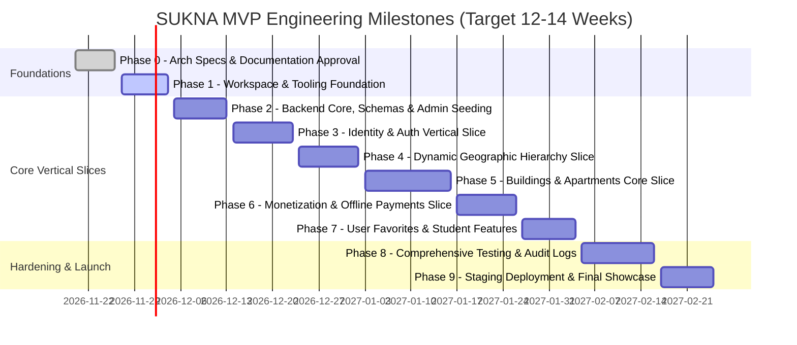

# SUKNA (سُكنا) — Engineering Development Roadmap & Milestone Schedule

> **Document Version:** 2.0.0  
> **Development Model:** Solo Engineer Iterative Vertical-Slice Cycle  
> **Philosophy:** Architecture-First, Quality over Speed, Realistic Learning Pacing  
> **Status:** Architectural Planning Baseline (Phase 0 in Progress)

---

## 1. Roadmap Strategy & Realistic Timeline Estimation

The engineering roadmap for SUKNA is designed around **functional vertical slices** rather than fragmented horizontal layers. A vertical slice delivers a cohesive feature set from database models through backend APIs to frontend user interfaces and automated tests.

Because this project is built by an engineer focusing on mastery, security, and architectural rigor, timelines are presented as **milestone targets** rather than guaranteed delivery dates.

---

## 2. Milestone-by-Milestone Execution Plan

### Phase 0: Product Requirements & Architecture Approval (CURRENT)
- **Goal:** Formalize all functional, database, API, security, and UI/UX requirements.
- **Tasks:**
  1. Complete 10 master documentation specifications in `docs/`.
  2. Align brand identity: Deep Forest Green (`#123B35`), Warm Orange (`#E88A35`), Warm Off-White (`#F7F5F0`), Charcoal (`#252B28`), Inter font (English LTR primary).
  3. Validate database invariants (hierarchical locations, renewal history, immutable snapshots, status separation).
  4. Perform cross-document consistency audit.
- **Acceptance Criteria:** Zero application code written without formal developer consensus.

---

### Phase 1: Workspace & Tooling Foundation
- **Goal:** Scaffold the monorepo root and workspace packages with standard tooling.
- **Tasks:**
  1. Configure root `package.json` with npm workspaces (`apps/website`, `apps/dashboard`, `apps/server`).
  2. Setup `.gitignore`, `.editorconfig`, ESLint, and Prettier.
  3. Initialize Express server skeleton in `apps/server`.
  4. Initialize React + Vite + Tailwind CSS + Ant Design in `apps/dashboard`.
  5. Initialize Next.js 14/15 App Router + Tailwind CSS in `apps/website`.
- **Testing:** Verify clean build and linting across all three workspaces.

---

### Phase 2: Backend Core, Schemas & Admin Seeding
- **Goal:** Establish MongoDB Atlas connectivity and implement Mongoose models.
- **Tasks:**
  1. Configure resilient MongoDB connection logic in `apps/server/src/config/db.ts`.
  2. Implement Mongoose schemas: `User`, `VerificationCode`, `Location`, `Building`, `Apartment`, `AdvertisingPackage`, `AdvertisingOrder`, `PaymentRecord`, `AuditLog`.
  3. Configure compound unique indexes, TTL auto-deletion indexes, and pre-save hooks.
  4. Implement `seedAdmin.ts` CLI script to provision the primary admin from `.env` secrets.
- **Testing:** Unit tests verifying schema validations, default values, and idempotent admin seeding.

---

### Phase 3: Identity & Authentication Vertical Slice
- **Goal:** Build bulletproof email registration, 6-digit HMAC OTP verification, session management, and password recovery.
- **Tasks:**
  1. Backend: Implement `/api/v1/auth/*` endpoints with Zod validators.
  2. Backend: Implement OTP generation with leading zero preservation and HMAC-SHA-256 storage (`codeHmac`).
  3. Backend: Implement `tokenVersion` session revocation in auth middleware and cookies (`HttpOnly`, `SameSite=Lax`, `Secure`).
  4. Website: Build public authentication pages (`/login`, `/register`, `/verify-email`, `/forgot-password`, `/reset-password`).
  5. UI: Implement accessible 6-digit visual OTP input component with paste and auto-advance.
  6. Dashboard: Configure Redux RTK Query auth slice and route guards (`<ProtectedRoute>`, `<AdminRoute>`).
- **Testing:** Unit test OTP attempt lockout ($\ge 5$ attempts), expiration, and `tokenVersion` invalidation.

---

### Phase 4: Dynamic Geographic Hierarchy Vertical Slice
- **Goal:** Complete end-to-end 3-tier location hierarchy management.
- **Tasks:**
  1. Backend: Implement `Location` CRUD and `GET /locations/tree` with strict parent-child validation.
  2. Dashboard: Build Locations Management control panel (Tree table, add governorate/city/area modal, active toggle).
  3. Website: Build hierarchical cascaded dropdown selectors (Governorate $\to$ City $\to$ Area) for property search filters.
- **Testing:** Integration tests asserting that mismatched geographic combinations are rejected with HTTP 400.

---

### Phase 5: Buildings & Apartments Core Vertical Slice
- **Goal:** Deliver physical building management, apartment listings, public discovery, and protected contact disclosure.
- **Tasks:**
  1. Backend: Implement Building and Apartment CRUD with soft-deletion and archiving endpoints.
  2. Backend: Implement protected landlord contact endpoint (`GET /apartments/:id/contact`) with email verification and rate limit guards.
  3. Backend: Implement server-proxied Cloudinary upload with magic-bytes buffer inspection.
  4. Dashboard: Build Buildings management view (create/edit/archive) and Apartments moderation view (status transitions, internal notes).
  5. Website: Build public property catalog (`/apartments`) with multi-filter sidebar/mobile bottom sheet and `/apartments/:id` detail page with gallery and external Google Maps links.
  6. UI: Build protected contact disclosure modal prompting guests to log in and revealing formatted phone/WhatsApp link for verified users.
- **Testing:** Verify that public listing endpoints strictly strip `ownerPhone`, and unauthenticated requests to `/contact` receive HTTP 401.

---

### Phase 6: Monetization & Offline Payments Vertical Slice
- **Goal:** Deliver advertising packages, historical order snapshotting, renewals, and manual payment auditing.
- **Tasks:**
  1. Backend: Implement Advertising Packages and Orders CRUD with package snapshotting.
  2. Backend: Implement manual payment confirmation (`POST /orders/:id/payments`) transitioning order to active.
  3. Dashboard: Build Packages configuration UI and Orders table with renewal history.
  4. Dashboard: Build Manual Payment Settlement modal (recording amount, method, external receipt reference).
  5. Website: Build public `/packages` overview page with WhatsApp contact CTA.
- **Testing:** Integration test confirming that modifying package prices never mutates previously booked order snapshots.

---

### Phase 7: User Favorites & Student Features Vertical Slice
- **Goal:** Deliver personalized bookmarks and student seeker features.
- **Tasks:**
  1. Backend: Implement `/api/v1/favorites` endpoints for regular users (`role: 'user'`).
  2. Backend: Validate that soft-deleted or unpublished apartments cannot be favorited.
  3. Dashboard / Portal: Build Saved Favorites grid with quick navigation to listings and direct removal.
  4. Dashboard: Build user profile and change password forms.
- **Testing:** Integration test asserting compound unique index prevents duplicate favorites.

---

### Phase 8: System Hardening, Audit Logging & Comprehensive Testing
- **Goal:** Full-cycle platform verification, security auditing, and automated testing suite.
- **Tasks:**
  1. Audit Logging: Finalize `audit_logs` tracking across all admin actions and contact reveals.
  2. Security Verification: Execute automated checks for NoSQL injection, XSS escaping, CSRF header enforcement, and brute-force lockouts.
  3. Responsive UI Audit: Verify mobile bottom sheets, dashboard slide-over drawer, and Cairo RTL layout consistency.
  4. Accessibility: Conduct WCAG 2.1 AA audit on color contrast, keyboard navigation, and screen reader announcements.

---

### Phase 9: Staging Deployment & Final Showcase
- **Goal:** Deploy unified staging platform and prepare final evaluation materials.
- **Tasks:**
  1. Deploy Backend API to cloud hosting (Render / Railway / DigitalOcean) connected to MongoDB Atlas.
  2. Deploy Website and Dashboard to Vercel with environment configurations.
  3. Verify cross-origin credentials and cookie transport in staging environment.
  4. Seed demo dataset (representative buildings and apartments in Qena, Sohag, and Minya).
  5. Conduct final end-to-end evaluation walkthrough.

---

## 3. Comprehensive Testing Strategy

To guarantee software quality without sacrificing learning time, the testing suite spans six critical domains:

| Testing Domain | Tools & Frameworks | Key Test Cases |
| :--- | :--- | :--- |
| **1. Unit Testing** | Vitest / Jest | - OTP generation (leading zero preservation). - HMAC-SHA-256 hash verification. - Zod schema validation rules. - Rental price per unit calculations. |
| **2. API Integration Testing** | Supertest | - Registration $\to$ OTP verification $\to$ Login flow. - Geographic tree hierarchy validation (reject mismatched parents). - Soft deletion preserving financial records. - Rate limiting on auth and contact disclosure routes. |
| **3. Authentication & Security Testing** | Custom Scripts / Supertest | - `tokenVersion` invalidation terminates active sessions. - Public endpoints omit `ownerPhone`. - Non-admin blocked from admin routes (HTTP 403). - Binary magic bytes rejection for invalid file signatures. |
| **4. End-to-End (E2E) Testing** | Playwright | - Guest browsing $\to$ Filter by Qena/price $\to$ View apartment $\to$ Prompted to login. - Admin login $\to$ Create building $\to$ Create apartment $\to$ Publish listing. - Admin records offline payment and confirms order. |
| **5. Responsive UI & RTL Testing** | Playwright / Browser Tools | - Mobile slide-over drawer opens and closes cleanly. - Mobile bottom-sheet filters on public website. - Cairo typography and layout symmetry in Arabic RTL mode. |
| **6. Accessibility Testing** | Axe-core / Lighthouse | - Color contrast compliance across warm palette ($\ge 4.5:1$). - Visible focus rings on all interactive elements. - 6-digit OTP input keyboard and screen-reader accessibility. |
