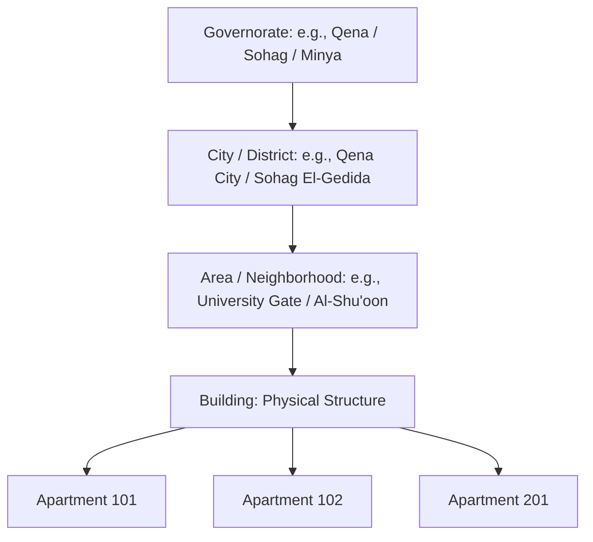
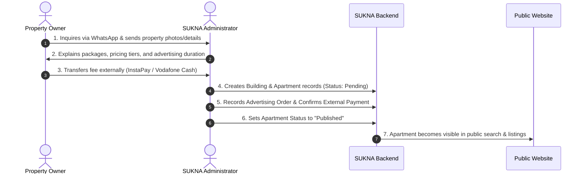

# SUKNA (سُكنا) — Project Overview & Master Product Brief

> **Document Version:** 2.0.0  
> **Status:** Discovery & Architecture Planning Phase (PLANNING ONLY)  
> **Last Updated:** November 2026  
> **Target Audience:** Engineering Team, Product Stakeholders, Project Evaluators (DEPI)

---

## 1. Executive Summary

**SUKNA (سُكنا)** is a specialized residential and student housing discovery marketplace initially targeting university cities in Upper Egypt: **Qena (قنا)**, **Sohag (سوهاج)**, and **Minya (المنيا)**. 

SUKNA is not merely a static website that displays apartments. It is an organized, scalable housing marketplace engineered to eliminate the severe information asymmetry, fragmentation, and safety concerns currently plaguing regional student housing in Egypt. The platform enables students, young professionals, and relocating individuals to discover verified buildings, browse individual apartments, view authentic interior/exterior photographs, verify amenities, inspect precise geographic locations via external Google Maps links, and securely access landlord/owner contact information.

To guarantee high listing authenticity and low onboarding friction in Upper Egypt, property owners do not manage complex self-service dashboards during the MVP. Instead, SUKNA employs an **admin-managed concierge model via WhatsApp**, where platform administrators curate, verify, price, and publish listings while recording offline payments (e.g. InstaPay and Vodafone Cash).

The platform architecture is designed from Day 1 to support additional Egyptian governorates and cities dynamically through an intuitive Admin Dashboard without requiring code modifications or redeployments.

---

## 2. Product Identity & Brand Positioning

- **Brand Name:** SUKNA — سُكنا (Derived from the classical Arabic root for *dwelling, serenity, and residence*).
- **Product Category:** Student & Residential Housing Discovery Marketplace.
- **Brand Personality:** Trustworthy, Modern, Warm, Professional, Human-Centered, Clean, Approachable, Grounded in Real Estate.
- **Visual Palette Identity:**
  - **Primary (Deep Forest Green - `#123B35`):** Establishes institutional dependability, serenity, and stability.
  - **Accent (Warm Orange - `#E88A35`):** Conveys warmth, hearth, approachable hospitality, and visual focus for key CTAs and pricing highlights.
  - **Canvas (Warm Off-White - `#F7F5F0`):** Replaces sterile pure white with comfortable warmth.
  - **Surfaces (Pure White - `#FFFFFF`):** High-definition cards and form surfaces with crisp border definition.
  - **Typography (Charcoal - `#252B28`):** High-contrast, fatigue-free reading experience for Arabic and tabular numbers.
- **Primary Audience:**
  1. **University Students & Relocating Renters:** Seeking safe, affordable, verified accommodations near regional university campuses.
  2. **Parents & Guardians:** Seeking reliable, institutional transparency regarding accommodation safety and landlord details.
  3. **Property Owners & Landlords:** Seeking high-intent student visibility without spammy social media chaos, supported by direct administrator coordination via WhatsApp.

---

## 3. Business Problem & Solution Matrix

| Market Pain Point | The SUKNA Solution |
| :--- | :--- |
| **Scattered, Fleeting Information:** Listings are scattered across private Facebook groups, transient WhatsApp statuses, and paper flyers on university walls. | **Centralized Discovery Hub:** A single structured, indexed, searchable web catalog for buildings and independent apartments. |
| **Vague or Inaccurate Details:** Crucial details like floor level, room counts, bathroom counts, and rental terms are missing or misleading. | **Standardized Apartment Metadata:** Enforced schema attributes: bedrooms, bathrooms, floor, furnished status, transparent pricing units (per person vs. per room vs. entire flat), and photo galleries. |
| **Geographic Ambiguity:** Students cannot verify physical proximity to campus, university gates, or public transit. | **Verified Google Maps Deep Links:** Direct external Google Maps links (`maps.app.goo.gl`) opened safely without costly embedded map SDK overhead. |
| **Harassment & Public Phone Harvesting:** Landlords hesitate to share phone numbers publicly; numbers are poached by brokers and spammers. | **Protected Contact Disclosure:** Landlord phone numbers are strictly gated behind authenticated, email-verified user accounts with rate limiting and audit logging. |
| **High Friction for Property Onboarding:** Traditional self-service landlord portals suffer from severe abandonment and poor listing data in regional Egypt. | **Admin-Assisted Concierge Workflow:** Property owners submit details via WhatsApp; platform administrators verify, format, and publish listings. |

---

## 4. Initial Geographic Coverage Strategy

The platform launches initially across three strategic governorates in Upper Egypt:

1. **Qena (قنا):** Serving South Valley University (جامعة جنوب الوادي) and surrounding institutes.
2. **Sohag (سوهاج):** Serving Sohag University (Old Campus in Nasr City & New Campus in El-Kawamel).
3. **Minya (المنيا):** Serving Minya University along the Nile Corniche and New Minya expansions.

### Architectural Imperative: Dynamic Coverage
Under no circumstances are governorate names or city hierarchies hardcoded into business logic or frontend presentation components. All geographic tiers (Governorates $\to$ Cities $\to$ Areas) are dynamically modeled in MongoDB and managed entirely via the Admin Dashboard.

---

## 5. Monetization & Business Model

SUKNA operates on a **B2B / B2C Hybrid Advertising Marketplace Model**:
- **Browsing is Free for Renters:** Students and prospective tenants browse listings and access verified landlord contacts at zero cost (requiring only an authenticated, email-verified account).
- **Listing & Promotion Fees for Landlords:** Property owners pay listing and promotional advertising fees based on duration and tier.
- **Concierge Offline Payment in MVP:** To eliminate regulatory, payment gateway, and PCI-DSS overhead during initial launch in Egypt, payments are conducted via external channels (InstaPay, Vodafone Cash, or direct bank transfer). Admins manually record, audit, and confirm payments before activating or featuring listings.
- **No Online Booking / Payments in MVP:** SUKNA does not process rental transactions, deposits, or online rent payments in the MVP.
- **Renewal Support:** Landlords can renew placements over time, generating sequential advertising orders for the same apartment.

---

## 6. Monorepo Structural Philosophy

To ensure maintainability for a solo engineer while strictly separating concerns, SUKNA employs an organized monorepo structure:
- **`apps/website`:** Public-facing Next.js application delivering fast Server-Side Rendering (SSR), Static Site Generation (SSG) for static marketing content, and search-engine indexable property pages.
- **`apps/dashboard`:** Client-Side Single Page Application (SPA) powered by React.js + Vite, Redux Toolkit, and RTK Query, housing both the comprehensive Admin Back-Office and the clean User Portal.
- **`apps/server`:** Centralized Express.js + Node.js REST API and MongoDB/Mongoose layer acting as the single source of truth for authentication, business rules, RBAC, and data persistence.
- **`docs`:** Living architectural, security, database, and API specifications.

---

## 7. User Roles & Access Boundaries

The platform strictly defines **only two system roles** in the MVP:
1. **Regular User (`user`):** Renters, students, and property seekers who register publicly, verify their email via OTP, save favorites, and reveal landlord contact information.
2. **Administrator (`admin`):** Platform managers who control listings, locations, packages, offline payments, and user accounts. Provisioned exclusively via an offline CLI seed script.

> **Crucial Architecture Decision:** Property Owners do **NOT** have system user accounts in the MVP. They interface with administrators via WhatsApp concierge workflows. No owner registration, login, or portal shall be created.

---

## 8. Strict Planning-Phase Restrictions

In compliance with project governance:
- **No production or application source code** may be initiated, installed, or deployed prior to comprehensive architectural review and explicit developer approval.
- All decisions, schemas, and API contracts defined in this documentation directory constitute the engineering baseline for subsequent implementation phases.
