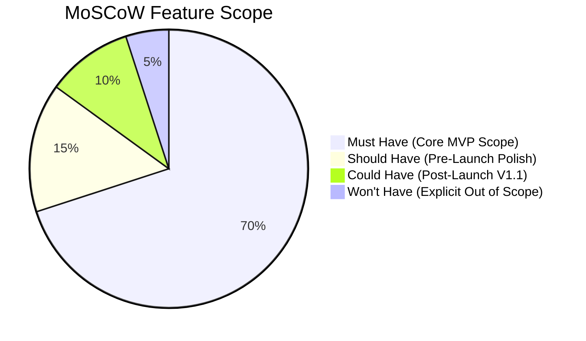

# SUKNA (سُكنا) — Functional & Non-Functional Requirements Specification

> **Document Version:** 2.0.0  
> **Status:** Architectural Planning Baseline (Refined Invariants & Business Logic)  
> **Methodology:** MoSCoW Prioritization (Must Have, Should Have, Could Have, Won't Have)

---

## 1. System Stakeholders & User Roles

The MVP implements exactly **two** registered account roles:
1. **Regular User (`user`):** Renters, students, and general property seekers who register publicly, verify their email via OTP, save favorites, and reveal landlord contact information.
2. **Administrator (`admin`):** Platform managers who control content, publish listings, manage geographic trees, oversee monetization, confirm offline payments, and administer users.

> **Crucial Architecture Decision:** Property Owners do **NOT** have system user accounts in the MVP. They interface with administrators via WhatsApp concierge workflows. No owner registration, login, or landlord portal shall be created.

---

## 2. Role-Based Access Control (RBAC) Matrix

| Feature / Capability | Public (Guest) | Regular User (`user`) | Administrator (`admin`) |
| :--- | :---: | :---: | :---: |
| Browse Published & Available Properties | ✅ | ✅ | ✅ |
| Search & Filter Properties (Gov/City/Area/Price/Type) | ✅ | ✅ | ✅ |
| View Building & Apartment Details & Galleries | ✅ | ✅ | ✅ |
| Open Google Maps External Deep Link | ✅ | ✅ | ✅ |
| View Public Advertising Package Options | ✅ | ✅ | ✅ |
| Register Account with Email Verification (OTP) | ✅ | ❌ (Already registered) | ❌ (Script-seeded only) |
| Log In, Check Session (`/auth/me`), Recover Password | ✅ | ✅ | ✅ |
| **Reveal Landlord Phone Number** | ❌ (Prompted to Login) | ✅ (Requires Verified Email) | ✅ |
| Add / Remove Apartments to Favorites | ❌ | ✅ (Active Properties Only) | ❌ (User feature only) |
| View Personal Saved Favorites | ❌ | ✅ | ❌ |
| Update Personal Profile & Change Password | ❌ | ✅ | ✅ |
| Access Admin Dashboard & System Metrics | ❌ | ❌ (HTTP 403 Forbidden) | ✅ |
| Create / Edit / Archive / Soft-Delete Buildings | ❌ | ❌ | ✅ |
| Create / Edit / Soft-Delete Apartments | ❌ | ❌ | ✅ |
| Moderate Listings (Publish / Reject / Unpublish) | ❌ | ❌ | ✅ |
| Manage Dynamic Coverage Tree (Gov/City/Area) | ❌ | ❌ | ✅ |
| Manage Advertising Packages (Create / Edit / Toggle) | ❌ | ❌ | ✅ |
| Create Advertising Orders & Record Manual Payments | ❌ | ❌ | ✅ |
| View User Directory & Toggle Account Status | ❌ | ❌ | ✅ |
| View Admin Platform Audit Logs | ❌ | ❌ | ✅ |

---

## 3. Functional Requirements (FR)

### Module 1: Authentication & Identity Management
- **FR-AUTH-01 (Public Registration):** Guests register using Full Name, Email, Password, and Password Confirmation. Passwords must be at least 8 characters with alphanumeric requirements.
- **FR-AUTH-02 (Secure OTP Generation):** The system generates a cryptographically secure 6-digit numeric verification code using `crypto.randomInt(0, 1000000)` formatted with `padStart(6, '0')` to preserve leading zeros, expiring in exactly 5 minutes.
- **FR-AUTH-03 (HMAC-SHA-256 Storage):** Plaintext OTPs and raw SHA-256 hashes are strictly prohibited. Codes are hashed using `HMAC-SHA-256` keyed with `OTP_SECRET` combined with the user's email and purpose before persistence in the `verification_codes` collection.
- **FR-AUTH-04 (Transactional Email Dispatch):** Verification emails are dispatched asynchronously via a transactional mail provider (Brevo evaluated; PENDING).
- **FR-AUTH-05 (Lockout & Rate Limiting):** A maximum of 5 failed verification attempts are allowed per code before forced destruction. Resend requests enforce a 60-second cooldown timer. Only one active code may exist per email and purpose.
- **FR-AUTH-06 (Account Activation):** Accounts remain in `isVerified: false` state until OTP verification succeeds. Unverified accounts cannot authenticate.
- **FR-AUTH-07 (Secure Login & Token Transport):** Authenticated sessions receive an `HttpOnly`, `SameSite=Lax`, `Secure` (in production) cookie (`sukna_token`). Tokens are never returned in JSON or stored in browser `localStorage`.
- **FR-AUTH-08 (Session & Token Revocation):** Each user record maintains a `tokenVersion: Number`. Upon logout, password change, or admin deactivation, the server increments `tokenVersion`, instantly invalidating all active JWT sessions across all devices.
- **FR-AUTH-09 (Password Recovery Flow):** Forgot password flow dispatches a single-use 6-digit reset code via email with generic success messaging to prevent email enumeration.
- **FR-AUTH-10 (Admin Seeding & Self-Protection):** Public registration of admin accounts is strictly prohibited. The initial admin is provisioned exclusively via a secure CLI script (`seedAdmin.ts`). Administrators are programmatically prevented from deactivating their own account or the last remaining active administrator.

### Module 2: Buildings & Apartments Hierarchy
- **FR-PROP-01 (Entity Separation):** Buildings and Apartments are independent collections linked by a `1:N` foreign key reference (`buildingId`). A building houses multiple apartments.
- **FR-PROP-02 (Building Attributes):** Each building encapsulates: Name, Description, Main Cover Image (Cloudinary URL and `public_id`), Optional Additional Photos, Geographic References (`governorateId`, `cityId`, `areaId`), Textual Street Address, Google Maps URL, `isActive`, `isArchived`, `isDeleted`, and `deletedAt`.
- **FR-PROP-03 (Apartment Attributes):** Each apartment encapsulates: Title, Building Reference, Description, Monthly Rental Price (EGP), Rental Type (`entire`, `shared`, `private_room`), Bedroom Count, Bathroom Count, Floor Number, Furnished Status (`furnished`, `semi_furnished`, `unfurnished`), Image Gallery (URLs and `public_ids`), Owner Name, Owner Phone (E.164 format), Listing Status, Availability Status, `rejectionReason`, `internalAdminNotes`, `isDeleted`, and `deletedAt`.
- **FR-PROP-04 (Geographic Tree Validation):** When creating or updating a building, backend validation strictly enforces that `governorateId`, `cityId`, and `areaId` match the actual database tree hierarchy. Inconsistent combinations are rejected with HTTP 400.
- **FR-PROP-05 (External Google Maps Links):** Locations are exposed strictly via direct external Google Maps deep links (`maps.app.goo.gl` or `google.com/maps`). Embedded map iframes or billing-gated Map SDKs are strictly excluded.
- **FR-PROP-06 (Protected Contact Disclosure):** Landlord phone numbers are filtered out of all public APIs. A dedicated protected endpoint (`GET /api/v1/apartments/:id/contact`) discloses the number only to authenticated, email-verified, active users. Enforces a 20-call/hour rate limit and records an audit log event.

### Module 3: Listing Lifecycle & Workflow
- **FR-LIST-01 (Independent Status Separation):** Listing Status (`pending`, `published`, `rejected`, `unpublished`), Availability Status (`available`, `rented`), Advertising Payment Status (`unpaid`, `paid`), and Building Status (`isActive`, `isArchived`) operate independently.
- **FR-LIST-02 (Public Search Visibility Invariant):** Public search results return listings if and only if: `apartment.isDeleted === false`, `apartment.listingStatus === 'published'`, `apartment.availabilityStatus === 'available'`, `building.isActive === true`, `building.isArchived === false`, `building.isDeleted === false`, and all parent location tiers are active. Rented apartments are excluded from regular search queries.
- **FR-LIST-03 (Admin Moderation & Note Separation):** Administrators can moderate listing status at any time. The system strictly separates public `rejectionReason` (sent to landlord) from confidential `internalAdminNotes`.
- **FR-LIST-04 (Soft Deletion & Cascade Prohibition):** Deleting a building or apartment sets `isDeleted: true` and `deletedAt = Date.now()`. Deletions **never cascade** to delete historical advertising orders, payment records, or audit logs.

### Module 4: Dynamic Geographic Management
- **FR-GEO-01 (3-Tier Hierarchy):** Support a strict 3-tier structure: Governorate $\to$ City/District $\to$ Area/Neighborhood.
- **FR-GEO-02 (Dynamic Admin Management):** Admins can add, rename, reorder, and toggle active states for any tier via the Admin Dashboard with zero code deployments.
- **FR-GEO-03 (Safe Deactivation):** Deactivating a governorate or city suppresses it from public discovery search filters while strictly preserving all linked historical properties and financial records.

### Module 5: Monetization & Offline Payments
- **FR-MON-01 (Advertising Packages):** Admins configure advertising tiers (Title, Duration in days, Benefits, Featured flag, Display Order, Active flag). All pricing figures are placeholders until commercially approved.
- **FR-MON-02 (Immutable Package Snapshots):** Creating an Advertising Order stores an immutable subdocument copy (`packageSnapshot`) containing `{ nameAr, nameEn, price, durationDays, benefits }` at the time of purchase. Future package edits never mutate past orders.
- **FR-MON-03 (Multiple Orders per Property & Renewals):** An apartment supports multiple sequential advertising orders over time ($1:N$). Renewing an advertisement generates a new order document while preserving historical order records.
- **FR-MON-04 (Single Full Payment per Order in MVP):** In the MVP, each advertising order is settled via a single full payment (`1:1`). Partial payments, installment plans, and online gateways are out of scope.
- **FR-MON-05 (Manual Payment Settlement & State Transition):** Admins manually record external transactions (InstaPay, Vodafone Cash, Bank Transfer). Upon payment confirmation, `paymentStatus` transitions to `'paid'`, `orderStatus` transitions to `'active'`, `startDate` is recorded, and `endDate` is calculated.

### Module 6: User Favorites
- **FR-FAV-01 (User-Only Persistence):** Authenticated regular users (`role: 'user'`) can bookmark apartments.
- **FR-FAV-02 (Active Listing Validation):** Users are prevented from adding soft-deleted, unpublished, or unavailable apartments to their favorites.
- **FR-FAV-03 (Duplicate Prevention):** MongoDB compound unique index `{ userId: 1, apartmentId: 1 }` guarantees idempotent favorite toggling.

### Module 7: Administrative Audit Logging
- **FR-AUD-01 (Audit Trail):** Captures critical administrative operations (property creation/updates/status changes, archiving, soft deletion, payment confirmations, location toggling, user status toggling, and landlord contact reveals).
- **FR-AUD-02 (Strict Privacy Invariant):** Passwords, bcrypt hashes, plain/hashed OTPs, JWT tokens, and sensitive authentication headers are strictly prohibited from appearing in audit logs or console outputs.

---

## 4. Non-Functional Requirements (NFR)

### NFR-SEC: Security & Compliance
- **NFR-SEC-01:** Passwords must be hashed using `bcrypt` with a minimum cost factor of 12 rounds.
- **NFR-SEC-02:** JWT tokens must be stored in secure, `HttpOnly`, `SameSite=Lax` cookies with `Secure=true` in production.
- **NFR-SEC-03:** `tokenVersion` check on incoming authenticated requests guarantees real-time session invalidation upon logout or deactivation.
- **NFR-SEC-04:** Strict CORS origin whitelisting (`WEBSITE_URL`, `DASHBOARD_URL`) with `credentials: true`.
- **NFR-SEC-05:** Defense-in-depth CSRF mitigation requiring `X-Requested-With: XMLHttpRequest` custom header on state mutations.
- **NFR-SEC-06:** All input payloads validated via strict `Zod` schemas with `.strip()` to reject unexpected attributes.
- **NFR-SEC-07:** Media uploads validated via actual binary magic bytes (JPEG, PNG, WebP) and capped at 5MB per file.

### NFR-PERF: Performance & Scalability
- **NFR-PERF-01:** Next.js property listing pages must achieve an LCP $\le 2.0\text{s}$ over 4G mobile connections.
- **NFR-PERF-02:** Server API response times for indexed read operations must respond within $\le 150\text{ms}$ at 95th percentile.
- **NFR-PERF-03:** Cloudinary delivery must leverage automated format conversion (`f_auto`) and compression (`q_auto`).

### NFR-UX: User Experience & Accessibility
- **NFR-UX-01:** English (`lang="en"`, `dir="ltr"`) as the primary interface language using the Inter font family, with logical CSS properties for future Arabic RTL compatibility.
- **NFR-UX-02:** Desktop layout utilizes 90% viewport width model (max `1600px`).
- **NFR-UX-03:** Mobile dashboard uses a dedicated slide-over navigation drawer, never a permanently shrunken desktop sidebar.
- **NFR-UX-04:** Property cards must explicitly communicate whether pricing is per person, per room, or for the entire apartment.
- **NFR-UX-05:** Accessible 6-digit OTP component with auto-focus, paste support, arrow navigation, and screen reader announcements.
- **NFR-UX-06:** WCAG 2.1 AA compliant color contrast across the warm brand palette.

---

## 5. MoSCoW Feature Prioritization

### Must Have (P0 — Absolute MVP Scope)
1. Monorepo architecture setup (`apps/website`, `apps/dashboard`, `apps/server`).
2. Dual-role RBAC (`user`, `admin`) with secure backend CLI seed script for admin.
3. Registration + 6-digit email OTP verification + login + logout with `tokenVersion` invalidation + forgot password.
4. Independent Building and Apartment models with CRUD in Admin Dashboard.
5. Dynamic 3-tier geographic management (Governorates, Cities, Areas) with tree validation.
6. Protected owner phone number disclosure endpoint (requires auth, verified email, active account; rate limited; audit logged).
7. External Google Maps URL redirection (`target="_blank"`, `rel="noopener noreferrer"`).
8. Advertising Packages management + Advertising Orders with package snapshotting & renewal history.
9. Manual offline payment recording and status tracking.
10. Public Next.js portal (Homepage, Search/Filter, Building View, Apartment View).
11. React + Vite Admin & User Dashboard with RTK Query and Ant Design.
12. User Favorites management (regular users only).
13. Comprehensive Audit Log collection for administrative operations.

### Should Have (P1 — Pre-Launch Polish)
1. Server-proxied Cloudinary image optimization with magic-byte file signature validation and 5MB size limit.
2. Rich filter criteria (price range slider, rental type, bedrooms, floor, furnished status).
3. Responsive mobile bottom-sheet filters for the public website.
4. Mobile slide-over navigation drawer for the Admin Dashboard.

### Could Have (P2 — Fast Follow V1.1)
1. Multi-language toggle (Arabic primary $\leftrightarrow$ English secondary).
2. Direct WhatsApp click-to-chat button prefilled with property title and reference ID.
3. Apartment comparison tool (side-by-side comparison of 2-3 listings).

### Won't Have (Explicitly Out of MVP Scope)
1. In-app automated payment gateway integration (Stripe, Paymob, Fawry).
2. Direct Property Owner registration, self-service portals, or landlord dashboards.
3. Real-time in-app chat between tenants and landlords.
4. In-app property reservation, booking, or deposit transactions.
5. Native mobile applications (iOS/Android) — mobile web is prioritized.
