# SUKNA (سُكنا) — Security Architecture & Threat Mitigation Plan

> **Document Version:** 2.0.0  
> **Classification:** Engineering Security Specification  
> **Status:** Architectural Planning Baseline (Hardenings & Real-World Realism)

---

## 1. Threat Modeling & Attack Surface Analysis

```mermaid
graph TD
    Attack1[Phone Number Scraping & Poaching] --> Def1[Auth Gate + Email Verified + Rate Limiting + Audit Logging]
    Attack2[Brute Force / Credential Stuffing] --> Def2[bcrypt Cost 12 + IP & Account Rate Limiting]
    Attack3[OTP Interception / Offline Cracking] --> Def3[HMAC-SHA-256 Storage + 5-Min TTL + 5 Attempts Lockout]
    Attack4[Cross-Site Scripting XSS / Token Exfiltration] --> Def4[HttpOnly Secure Cookies + No LocalStorage Storage]
    Attack5[Token Theft / Inability to Revoke] --> Def5[tokenVersion Database Invalidation Pattern]
    Attack6[Cross-Site Request Forgery CSRF] --> Def6[SameSite Lax + Origin/Referer Checks + Custom Header Gate]
    Attack7[NoSQL Injection & Parameter Tampering] --> Def7[Zod Schema Validation + Allowlisted Query Construction]
    Attack8[Malicious Media Uploads] --> Def8[Magic Bytes Inspection + 5MB Size Cap + Cloudinary Isolation]
    Attack9[Admin Privilege Escalation] --> Def9[Offline CLI Seed Script + Self-Deactivation Guard]
```



---

## 2. Authentication & Credential Security

### 2.1. Password Hashing Specification
- **Algorithm:** `bcrypt` (Blowfish-based cipher).
- **Work Factor / Salt Rounds:** Minimum 12 rounds ($\approx 250\text{ms}$ computational delay per hash on standard modern cloud vCPU).
- **Mongoose pre-save Hook:** Intercepts password modifications and hashes before disk persistence.
- **Query Projection Invariant:** The `passwordHash` attribute on `User` schema is set to `select: false` by default, preventing accidental leakage in JSON serialization.

### 2.2. Seeded Administrator Account Protection
- **Zero Public Admin Registration:** The public registration endpoint rejects or strips any attempt to pass `role: 'admin'`. Public registration unconditionally provisions `role: 'user'`.
- **Command-Line Seeding (`seedAdmin.ts`):** Initial platform administrator is provisioned exclusively via an offline CLI script reading `ADMIN_EMAIL` and `ADMIN_PASSWORD` from `.env`.
- **Accidental Deactivation Defenses:**
  - An administrator is programmatically prevented from deactivating their own account (`req.user.id !== targetUser.id`).
  - An administrator is programmatically prevented from deactivating the last remaining active administrator in the system.
- **Realistic Security Assessment:**  
  *Seeding administrators via CLI prevents automated web registration attacks, but does not render the system completely invulnerable. Admin security depends critically on securing `.env` files, production host access (SSH), strong administrative passwords, and continuous audit logging.*

---

## 3. Session Management & Token Revocation Architecture

### 3.1. Stateless JWT with State-Aware Revocation
Relying solely on stateless JWTs introduces a dangerous vulnerability: **clearing a cookie on the client does NOT revoke a JWT**. If an attacker captures a valid JWT, it remains cryptographically valid until its expiration time.

To resolve this without the heavy performance hit of full database session lookups on every request, SUKNA implements a **`tokenVersion` invalidation pattern**:

```mermaid
sequenceDiagram
    autonumber
    actor User as User Browser
    participant API as Express API
    participant DB as MongoDB Atlas

    User->>API: 1. POST /api/v1/auth/login
    API->>DB: 2. Validate email & bcrypt password; fetch user.tokenVersion (e.g. 0)
    API->>User: 3. Issue HttpOnly cookie containing JWT { id, role, tokenVersion: 0 }
    Note over User,API: Normal Authenticated Requests
    User->>API: 4. Request with cookie (JWT tokenVersion: 0)
    API->>DB: 5. Verify user is active & user.tokenVersion === 0 -> Allow
    Note over User,API: Logout or Security Event (Password Change / Admin Deactivation)
    User->>API: 6. POST /api/v1/auth/logout
    API->>DB: 7. Increment user.tokenVersion to 1 & Clear Client Cookie
    Note over User,API: Attacker attempts using previously captured JWT (tokenVersion: 0)
    User->>API: 8. Request with old JWT (tokenVersion: 0)
    API->>DB: 9. DB tokenVersion is 1 !== JWT tokenVersion 0 -> REJECT HTTP 401
```

### 3.2. Token Lifecycle & Immediate Account Suspension
- **Token Claims:** Minimal payload: `{ id: string, role: string, tokenVersion: number }`.
- **Expiration Policy:** Access tokens expire in 7 days, but any change in `tokenVersion` or setting `user.isActive = false` immediately terminates access on the next API call.
- **Zero LocalStorage Policy:** JWTs are **never** returned in JSON payloads and **never** stored in browser `localStorage` or `sessionStorage`, protecting tokens from client-side XSS exfiltration.

---

## 4. Cookies, Cross-Site Scripting (XSS) & CSRF Defense

### 4.1. Cookie Delivery Configuration
Tokens are distributed via HTTP response headers:
```http
Set-Cookie: sukna_token=<JWT_STRING>; Path=/; HttpOnly; SameSite=Lax; Max-Age=604800; Secure; Domain=.sukna.com
```

- **Environment-Specific Cookie Directives:**
  - **Development (`localhost`):** `HttpOnly; SameSite=Lax; Path=/; Max-Age=604800` (`Secure` omitted so HTTP works locally; `Domain` omitted so it attaches to `localhost`).
  - **Production:** `HttpOnly; SameSite=Lax; Path=/; Max-Age=604800; Secure; Domain=.sukna.com` (Requires unified root domain across subdomains).

### 4.2. CSRF Defense-in-Depth (Beyond SameSite=Lax)
While `SameSite=Lax` offers protection against many cross-site requests, it allows top-level navigational GET requests and can exhibit edge-case vulnerabilities on older browsers or complex cross-subdomain hosting. SUKNA enforces defense-in-depth:

1. **Origin & Referer Header Validation:** Express middleware inspects incoming mutation requests (`POST`, `PUT`, `PATCH`, `DELETE`) and verifies that the `Origin` or `Referer` header matches the strictly allowlisted domain whitelist.
2. **Custom Header Requirement (`X-Requested-With`):** All AJAX/fetch mutations from the Next.js website and Vite Dashboard must include `X-Requested-With: XMLHttpRequest`. Standard HTML form cross-site submissions cannot attach custom headers without CORS preflight approval.

---

## 5. One-Time Password (OTP) Security Architecture

### 5.1. Cryptographic Generation & Leading Zero Preservation
- **Generation:** Generated via `crypto.randomInt(0, 1000000)` and formatted with `padStart(6, '0')`:
  ```typescript
  const code = crypto.randomInt(0, 1000000).toString().padStart(6, '0');
  ```
  This guarantees a uniform distribution across all 1,000,000 possibilities (including `000123`).

### 5.2. HMAC-SHA-256 Storage vs. Plain SHA-256
A 6-digit numeric space contains only $10^6$ combinations. A plain SHA-256 hash can be precomputed or cracked in fractions of a second using a rainbow table if the database is compromised.

**The SUKNA Solution:** Store codes as an HMAC-SHA-256 keyed with a high-entropy server secret (`OTP_SECRET`):
$$\text{codeHmac} = \text{HMAC-SHA-256}(\text{key} = \text{OTP\_SECRET},\; \text{data} = \text{code} + \text{email} + \text{purpose})$$
Without `OTP_SECRET`, an attacker possessing a leaked database cannot brute-force the 6-digit OTP offline.

### 5.3. Invariants & Lifecycle Controls
- **Strict Lifespan:** Exactly 5 minutes. MongoDB TTL index deletes expired records automatically.
- **Single Active Code Rule:** When a new code is requested, any existing codes for the same `{ email, purpose }` are deleted before creating the new code.
- **Purpose Separation:** Strict separation between `email_verification` and `password_reset`. A code generated for email verification cannot be submitted to reset a password.
- **Brute-Force Lockout:** Failed attempts increment `attempts`. If `attempts >= 5`, the code document is destroyed immediately.
- **Resend Cooldown:** 60-second cooldown enforced between generation requests per email address.
- **Zero Plaintext Logging:** Plaintext OTPs are **never** stored in database collections, server log files, or error messages.

---

## 6. Input Validation & Safe Query Construction

### 6.1. Strict Zod Schema Validation
Every incoming payload passes through an isolated `Zod` validation schema before reaching controller handlers. The parser is configured to strip (`.strip()`) unrecognized keys.

### 6.2. Safe Query Construction (NoSQL Injection Defense)
- **Prohibition of Direct Object Interpolation:** Raw `req.body` or `req.query` objects are **never** passed directly into Mongoose query methods (e.g., `Apartment.find(req.query)` is strictly forbidden).
- **Allowlisted Query Builder:** Query parameters are extracted individually, validated for type and format, and assembled into explicitly structured Mongoose filter objects.
- **Explicit Type Casting:** All route IDs are validated with `mongoose.isValidObjectId(id)` before casting via `new mongoose.Types.ObjectId(id)`.

---

## 7. Media Upload & Image Validation Security

Since administrators upload property photographs that are distributed via public CDNs, upload integrity is critical:

1. **File Size Cap:** Strictly capped at **5MB** per image.
2. **Gallery Quantity Limits:** Maximum 15 images for an apartment; maximum 5 images for a building.
3. **Magic Bytes File Signature Inspection:** Client-supplied `Content-Type` headers can be trivially spoofed. The backend inspects the actual initial binary buffer bytes:
   - JPEG: `FF D8 FF`
   - PNG: `89 50 4E 47`
   - WebP: `52 49 46 46` ... `57 45 42 50`
   Any file failing magic byte validation is rejected with HTTP 400.
4. **Cloudinary Asset Storage & Cleanup:**
   - Both the HTTPS CDN URL and the `public_id` are saved in the database.
   - When a property is updated with replacement photos or permanently deleted, the server calls Cloudinary's Admin API to destroy old assets, preventing storage bloat and orphan file accumulation.

---

## 8. Protected Landlord Contact Information (Anti-Scraping Defense)

### 8.1. Defense-in-Depth Implementation
1. **Public Listing Sanitization:** All public queries (`/api/v1/apartments` and `/api/v1/apartments/:id`) strictly strip `ownerPhone` from Mongoose projection and JSON serialization.
2. **Gated Disclosure Endpoint (`GET /api/v1/apartments/:id/contact`):**
   - Requires valid authenticated JWT cookie (`requireAuth`).
   - Requires verified email (`user.isVerified === true`).
   - Requires active user account (`user.isActive === true`).
   - Asserts apartment is valid, active, published, and physically available.
3. **Dedicated Rate Limiting:** Capped at **20 reveals per user per hour** using `express-rate-limit` with key generator based on `req.user.id`.
4. **Forensic Audit Logging:** Every disclosure records an `audit_logs` document with `action: 'CONTACT_INFO_REVEALED'`, linking the user ID, apartment ID, IP address, and timestamp.

### 8.2. Realistic Anti-Scraping Caveat
> **Important Product & Security Clarification:**  
> These layered protections eliminate automated web crawlers, search engine scrapers, and casual harvesting bots. However, because authenticated human users are granted access to legitimate contact numbers, no software architecture can mathematically guarantee 100% prevention against a determined human registering multiple verified accounts and manually transcribing numbers. Rate limits and audit logging ensure abuse is detected and throttled rapidly.

---

## 9. Security Audit Logging Policy

The `audit_logs` collection serves as a tamper-evident administrative record.

### 9.1. Mandatory Audited Events
- Property creation, updates, status transitions (publish, unpublish, reject).
- Property archiving and soft deletion.
- Location hierarchy creation, updates, and active state toggling.
- Manual advertising payment confirmations and rejections.
- User account activation and deactivation.
- Landlord contact information reveals.

### 9.2. Strict Logging Boundary
```
[CRITICAL INVARIANT]
The logging subsystem must NEVER serialize or log:
- Plaintext passwords or bcrypt hashes
- Plaintext OTP codes or HMAC digests
- JWT token strings or session cookies
- Credit card or bank credentials
```
