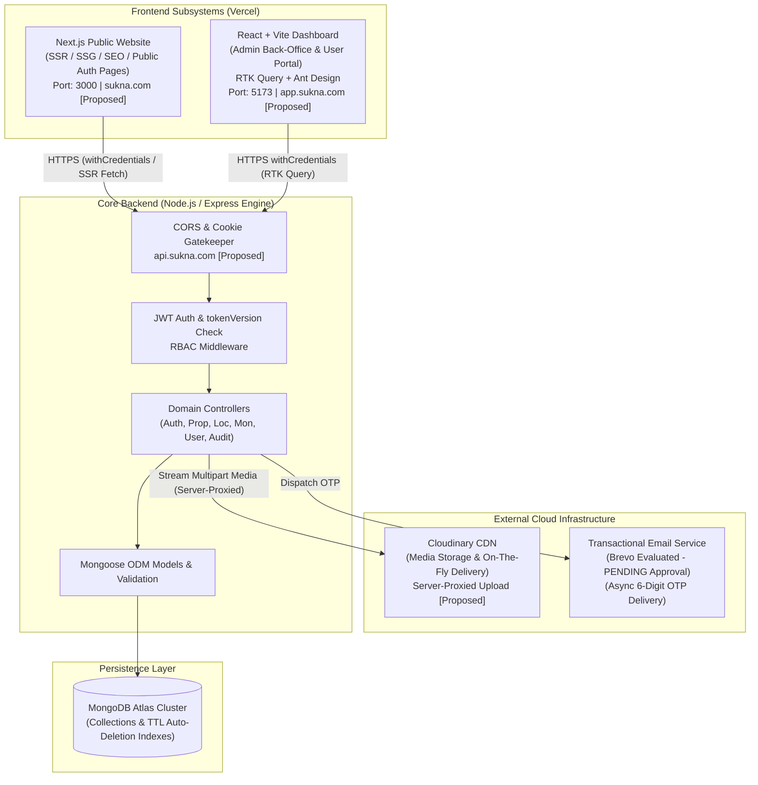
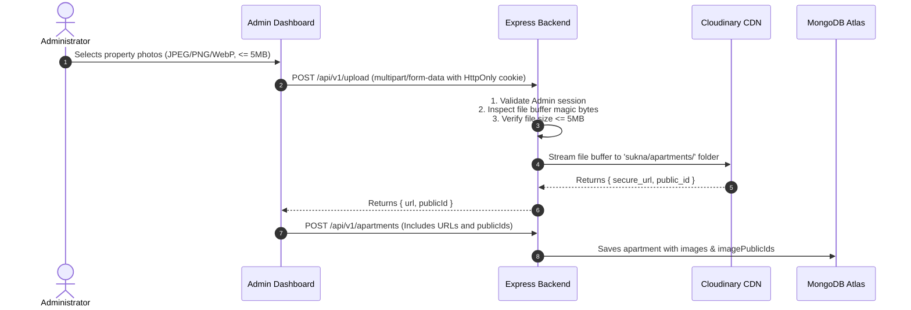

# SUKNA (سُكنا) — System Architecture Specification

> **Document Version:** 2.0.0  
> **Status:** Architectural Planning Baseline (Refined Stack, Auth & Cloud Topology)  
> **Target Deployments:** Vercel (Website & Dashboard) + Render/Railway/DigitalOcean (Express Backend & MongoDB Atlas)

---

## 1. High-Level System Architecture Diagram



---

## 2. Monorepo Structural Philosophy & Repository Layout

To maximize code clarity for an independent engineer without incurring the configuration baggage of complex monorepo tooling (like Nx or Turborepo), SUKNA uses standard **npm workspaces**.

```
sukna/
├── apps/
│   ├── website/                 # Public Next.js Web Portal
│   │   ├── src/
│   │   │   ├── app/             # App Router (layout.tsx, page.tsx, etc.)
│   │   │   │   ├── (public)/    # Route groups: buildings, apartments, packages
│   │   │   │   ├── (auth)/      # Public Auth Pages: login, register, verify-email, forgot-password
│   │   │   │   └── globals.css  # Tailwind base & RTL directives
│   │   │   ├── components/      # UI components (Hero, Navbar, Cards, Gallery, OTP Input)
│   │   │   ├── lib/             # API client, fetch helpers, formatters
│   │   │   └── types/           # Shared TypeScript interfaces [Proposed]
│   │   ├── package.json
│   │   └── tailwind.config.js
│   │
│   ├── dashboard/               # React + Vite Single Page Application
│   │   ├── src/
│   │   │   ├── app/             # Redux Store & Root config
│   │   │   ├── features/        # Slice-based feature modules
│   │   │   │   ├── auth/        # Session slice, auth guards (<ProtectedRoute>, <AdminRoute>)
│   │   │   │   ├── buildings/   # Buildings table, forms, modals, archiving
│   │   │   │   ├── apartments/  # Apartments table, filter drawers, status transitions
│   │   │   │   ├── locations/   # Dynamic Gov/City/Area tree management
│   │   │   │   ├── packages/    # Ad package management
│   │   │   │   ├── orders/      # Ad orders & manual payment recording modal
│   │   │   │   ├── users/       # User management table & status toggling
│   │   │   │   ├── audit/       # Platform audit logs table
│   │   │   │   └── favorites/   # User saved apartments grid
│   │   │   ├── services/        # RTK Query API slices (apiSlice.ts) - MANDATORY
│   │   │   ├── components/      # Shared layout (Sidebar, Mobile Drawer, Header, StatCards)
│   │   │   ├── hooks/           # Custom React hooks (useAuth, useRTL)
│   │   │   └── utils/           # Validation schemas (Zod), currency formatters
│   │   ├── package.json
│   │   └── vite.config.ts
│   │
│   └── server/                  # Node.js + Express REST API Backend
│       ├── src/
│       │   ├── config/          # DB connection, env variables, cloudinary, mailer
│       │   ├── controllers/     # Business logic handlers
│       │   ├── middleware/      # Auth (tokenVersion check), RBAC, error handling, rate limiting
│       │   ├── models/          # Mongoose schema definitions
│       │   ├── routes/          # Express route declarations
│       │   ├── scripts/         # Admin CLI seed script (seedAdmin.ts)
│       │   ├── utils/           # OTP generation (HMAC-SHA-256), token issuance
│       │   ├── validators/      # Zod validation schemas
│       │   └── app.ts           # Express server bootstrapping
│       ├── package.json
│       └── tsconfig.json
│
├── docs/                        # Complete System Specifications
├── package.json                 # Monorepo root package.json (workspaces defined)
└── README.md                    # Master developer onboarding guide
```

---

## 3. Technology Stack & Subsystem Roles

### 3.1. Public Website (`apps/website`)
- **Core Framework:** Next.js (App Router), React, Tailwind CSS.
- **Language:** TypeScript (*Proposed recommendation; awaiting final consensus*).
- **Primary Roles:**
  - High-performance, SEO-optimized public discovery platform for students and renters.
  - Server-Side Rendering (SSR) for `/apartments` search and `/apartments/:id` property detail pages to enable deep search engine indexing.
  - Static Site Generation (SSG) with ISR for informational pages (About, How it works, Advertising packages).
  - **Hosts Public Authentication UI:** Houses the public login, registration, email OTP verification, and password reset pages.
- **Data Fetching:** Native Next.js Server Components fetching from Express Backend via standard `fetch` with credential forwarding where appropriate.

### 3.2. Dashboard Application (`apps/dashboard`)
- **Core Framework:** React.js, Vite, React Router, Tailwind CSS, Ant Design (v5).
- **State Management & Network Layer:**
  - **Redux Toolkit (RTK):** Global UI state, authenticated user profile, mobile drawer states.
  - **RTK Query (Mandatory):** Centralized data fetching, caching, mutation lifecycle, and cache tag invalidation (`providesTags` / `invalidatesTags`).
  - **STRICT ARCHITECTURAL RULE:** Under no circumstances shall `axios` be introduced into `apps/dashboard`. RTK Query handles 100% of network communication.
- **UI & Form Architecture:** Ant Design configured with custom brand tokens (Deep Forest Green, Warm Orange, Warm Off-White, Cairo Arabic font) paired with `react-hook-form` and `zod` for type-safe form validations.
- **Icons & Visualization:** Lucide React for consistent icons, Recharts for admin KPI trends, Framer Motion for purposeful, restrained micro-interactions.

### 3.3. Centralized REST API Backend (`apps/server`)
- **Core Framework:** Node.js, Express.js, MongoDB, Mongoose ODM.
- **Authentication:** JWT signed with `HS256` secret, bcrypt ($\ge 12$ rounds), and state-aware `tokenVersion` revocation.
- **Session Transport:** HttpOnly, SameSite=Lax cookies.
- **Role:** Single source of truth for all business logic, RBAC enforcement, geographic tree validation, monetization tracking, and audit logging.

---

## 4. Authentication Architecture & Session Strategy

### 4.1. Preferred Authentication Architecture
- **Public Website Houses Auth Pages:** All public authentication views (`/login`, `/register`, `/verify-email`, `/forgot-password`, `/reset-password`) belong to the Next.js Public Website.
- **Centralized Backend Business Logic:** All authentication logic, OTP generation/validation, password hashing, and token issuance reside exclusively in `apps/server` (`/api/v1/auth/*`).
- **No Duplication:** Authentication business logic is **never** duplicated across frontend apps. When a user logs in on the Website, the session cookie is set; if the user possesses the `admin` role, they can seamlessly navigate to the Dashboard.

### 4.2. Proposed Production Domain & Cookie Strategy
```
[PROPOSED ARCHITECTURE - Pending Final Hosting & Domain Approval]
Root Domain:         sukna.com
Public Website:      https://sukna.com
Admin Dashboard:     https://app.sukna.com
Backend API:         https://api.sukna.com
```

#### Development vs. Production Cookie Configuration:
- **Local Development Environment:**
  - Website: `http://localhost:3000`
  - Dashboard: `http://localhost:5173`
  - Backend: `http://localhost:5000`
  - Cookie Config: `SameSite=Lax; HttpOnly; Path=/; Max-Age=604800` (`Secure=false`, `Domain` omitted). Since origins share `localhost`, credentials pass smoothly via `withCredentials: true`.
- **Production Environment:**
  - Cookie Config: `SameSite=Lax; HttpOnly; Path=/; Max-Age=604800; Secure=true; Domain=.sukna.com`.
  - Setting `Domain=.sukna.com` allows both `sukna.com` (Website) and `app.sukna.com` (Dashboard) to transmit the authentication cookie to `api.sukna.com` in cross-subdomain requests, satisfying browser same-site policies without relying on risky third-party cookie exemptions.

---

## 5. Media Management Pipeline (Cloudinary)

### 5.1. Server-Proxied Upload Architecture (PROPOSED for MVP)
Because the SUKNA MVP is an **admin-managed concierge marketplace** where only authenticated administrators upload building and apartment photographs, upload volume is controlled.

We propose a **Server-Proxied Upload Strategy** via Express using Multer memory storage and Cloudinary Node SDK streaming:



### 5.2. Safety Controls & Orphan Image Management
- **Magic Bytes Validation:** Upload middleware inspects actual initial buffer bytes (rejecting files whose binary signatures do not match JPEG, PNG, or WebP).
- **Public ID Storage:** Storing `public_id` alongside image URLs enables safe asset deletion.
- **Deletion & Cleanup Policy:** When a listing is updated with replacement images or soft-deleted, the backend triggers Cloudinary Admin API `uploader.destroy(public_id)` to purge orphaned assets.

---

## 6. Transactional Email Pipeline (Brevo Evaluated — PENDING Approval)

The platform requires asynchronous delivery of 6-digit verification and password reset OTPs.

- **Evaluated Provider:** **Brevo** (formerly Sendinblue) evaluated as the initial prototyping option.
- **Status:** **PENDING Developer Approval**.
- **Delivery Invariants:**
  1. Emails are dispatched asynchronously via background worker or non-blocking async calls to prevent API response latency.
  2. Branded HTML templates maintain SUKNA's warm palette (Forest Green `#123B35`, Warm Orange `#E88A35`, Cairo typography).
  3. If the email provider fails to deliver, the backend logs an error and returns an appropriate status allowing the user to trigger the 60-second resend cooldown.
  4. OTPs strictly expire in 5 minutes regardless of email transit delays.
