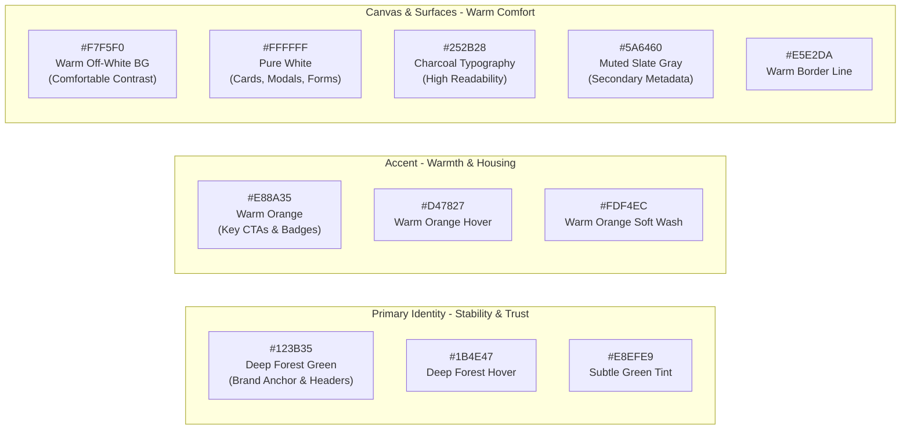

# SUKNA (سُكنا) — UI/UX Design System & Experience Guidelines

> **Document Version:** 2.0.0  
> **Status:** Architectural Planning Baseline (Brand Identity Refined)  
> **Primary Locale:** English (`en`, LTR Primary) with Arabic (`ar-EG`, RTL) Future Compatibility  
> **Design Personality:** Trustworthy, Modern, Warm, Professional, Human-Centered, Clean, Approachable, Grounded in Real Estate

---

## 1. Brand Identity & Design Philosophy

SUKNA (سُكنا) derives from the classical Arabic root for *dwelling, serenity, and residence*. It is built to serve university students, relocating individuals, and property managers across Upper Egypt (initially Qena, Sohag, and Minya).

### 1.1. Core Visual Principles
To avoid the appearance of a generic AI-generated template, sterile SaaS software, or chaotic local classifieds, SUKNA adheres to four foundational principles:

1. **Intentionally Art-Directed, Not Generic:** Avoid overused purple/indigo/electric-blue tech gradients and floating abstract shapes. The visual style reflects genuine physical living spaces: natural timber warmth, tranquil foliage, crisp architectural planes, and warm masonry tones.
2. **Warmth Balanced with Institutional Rigor:** University students and parents seeking housing require absolute peace of mind. Deep forest tones establish institutional trust and stability, while warm terracotta-orange accents convey hospitality, hearth, and human approachability.
3. **Calm, High-Information Density:** Every screen emphasizes scannability, transparent pricing units (per person vs. per room vs. entire unit), verified location badges, and authentic photographs without distracting animations.
4. **Arabic RTL First-Class Design:** Every layout, navigation drawer, card orientation, badge placement, and typography hierarchy is designed natively for Arabic script and right-to-left layout dynamics, rather than mirrored as an afterthought.

---

## 2. Proposed Brand Color Palette & Design Tokens

### 2.1. Core Palette Tokens



| Token Name | Hex Code | Role & Usage |
| :--- | :--- | :--- |
| `color-primary` | `#123B35` | **Deep Forest Green:** Brand identity, header navigation bars, primary headings ($H_1, H_2$), key structural elements. Represents stability and institutional trust. |
| `color-primary-hover` | `#1B4E47` | Slightly lightened forest green for hover/active states on primary navigation. |
| `color-primary-soft` | `#E8EFE9` | Very light forest green wash for selected navigation items, soft badges, and highlight banners. |
| `color-accent` | `#E88A35` | **Warm Orange:** Reserved for high-priority conversion CTAs, price accents, featured listing badges, interactive focus indicators, and key micro-accents. |
| `color-accent-hover` | `#D47827` | Deeper warm orange for active button presses and hover interactions. |
| `color-accent-soft` | `#FDF4EC` | Soft warm peach wash used as background behind featured listing tags and price pills. |
| `color-bg-canvas` | `#F7F5F0` | **Warm Off-White:** Main application and website page backgrounds. Softens glare and avoids sterile pure white plains. |
| `color-surface` | `#FFFFFF` | **Pure White:** Property cards, data tables, modals, input fields, dropdown menus, and sheet drawers. |
| `color-text-charcoal` | `#252B28` | **Charcoal Text:** Primary body copy, headings, and high-contrast numerical figures. Softer than jet black (`#000000`) for extended reading comfort. |
| `color-text-muted` | `#5A6460` | Secondary copy, breadcrumbs, specifications (floor, rooms), placeholder labels. |
| `color-text-light` | `#8C9691` | De-emphasized timestamps, disabled text, subtle helper notes. |
| `color-border-warm` | `#E5E2DA` | Standard container borders, card dividers, and subtle table cell gridlines. |
| `color-border-focused` | `#123B35` | High-contrast input and control focus borders. |

### 2.2. Functional & Semantic State Colors
Semantic colors are tuned to harmonize with the warm off-white and forest green canvas:

| Semantic State | Hex Code | Background Tint | Usage Context |
| :--- | :--- | :--- | :--- |
| **Success / Verified** | `#226E43` | `#EBF5EE` | Verified phone disclosed, payment confirmed, account active, listing published. |
| **Warning / Pending** | `#C77700` | `#FEF8EC` | Pending admin review, unverified email, unconfirmed offline payment. |
| **Danger / Rejected** | `#B92525` | `#FDF0F0` | Rejected listing, validation error, account suspended, delete confirmation. |
| **Info / Neutral** | `#205A87` | `#EDF5FB` | Information banners, external Google Maps link pills, system hints. |

### 2.3. Color Usage Rules & Anti-Patterns
To ensure visual discipline, designers and frontend engineers must obey the following boundaries:

- **Do NOT flood screens with Orange:** Orange (`#E88A35`) is an intentional accent. It must never serve as a large section background, modal backdrop, or full-width banner.
- **Do NOT flood screens with Dark Green:** Forest Green (`#123B35`) provides grounding structure. Avoid black-box interfaces where entire page bodies are green.
- **Maintain Surface Separation:** Use the warm off-white (`#F7F5F0`) for page canvas, allowing white (`#FFFFFF`) cards and panels to float with subtle definition via `1px solid #E5E2DA` rather than heavy drop shadows.
- **Prohibited Aesthetics:** No purple/violet AI-style glowing halos, neon cyberpunk highlights, or heavy multi-stop rainbow gradients.

---

## 3. Typography System (English LTR Primary, RTL-Ready)

### 3.1. Font Families
- **Primary Font Family (Default English Interface):** `'Inter', system-ui, -apple-system, BlinkMacSystemFont, 'Segoe UI', Roboto, sans-serif`
  - *Rationale:* Inter provides crisp geometric clarity, strong legibility at small UI sizes, and clean tabular numerals for pricing and room specifications.
- **Future Arabic RTL Font Family:** `'Cairo', system-ui, sans-serif` (reserved for future Arabic RTL localization).
- **Tabular Numerals:** For financial tables, prices, and room specifications, enable `font-feature-settings: 'tnum'` to preserve strict columnar alignment.

### 3.2. Typographic Hierarchy
| Level | Font Size | Line Height | Weight | Usage |
| :--- | :--- | :--- | :--- | :--- |
| **Display 1** | `36px` (`2.25rem`) | `1.25` | Bold (700) | Homepage hero slogan, major landing headlines |
| **Heading 1 ($H_1$)** | `28px` (`1.75rem`) | `1.3` | Bold (700) | Property detail title, dashboard section headers |
| **Heading 2 ($H_2$)** | `22px` (`1.375rem`) | `1.35` | SemiBold (600) | Card titles, modal headers, filter group titles |
| **Heading 3 ($H_3$)** | `18px` (`1.125rem`) | `1.4` | SemiBold (600) | Building cluster names, table subheaders |
| **Body Large** | `16px` (`1.0rem`) | `1.6` | Regular (400) / Medium (500) | Property descriptions, lead paragraphs |
| **Body Regular** | `14px` (`0.875rem`) | `1.5` | Regular (400) | Form inputs, card metadata, table cells |
| **Caption / Small** | `12px` (`0.75rem`) | `1.4` | Medium (500) | Badges, helper text, breadcrumbs, timestamp tags |

### 3.3. Directionality Rules
- Default document sets `<html lang="en" dir="ltr">`.
- Use logical CSS properties throughout (`margin-inline-start`, `padding-inline-end`, `inset-inline-start`) so future Arabic RTL support integrates cleanly.

---

## 4. Layout Architecture & Responsive Grids

### 4.1. Desktop Viewport Standard (90% Width Model)
- **Fluid Desktop Container:** On viewports $> 1280\text{px}$, the main content container utilizes approximately **90% of the viewport width**, clamped at a maximum ceiling of `1600px` (`max-w-[1600px] mx-auto px-4 md:px-8`).
- *Advantage:* Maximizes screen real estate for high-density property filtering and administrative data tables while preventing visual fatigue on ultra-wide displays.

### 4.2. Public Website Layout Grid
- **Header:** Sticky top navigation bar with clean branding, location switcher, search shortcut, and auth actions.
- **Search Catalog View:**
  - Desktop ($> 1024\text{px}$): 2-column layout — Sticky right-hand filter sidebar ($320\text{px}$ width in RTL) + Fluid left-hand property card grid (3 columns on standard screens, 4 columns on wide displays).
  - Mobile & Tablet ($\le 1023\text{px}$): Single column list with a prominent floating filter bar triggering a full-featured bottom sheet drawer.

### 4.3. Admin Dashboard Layout
- **Desktop Sidebar ($> 1024\text{px}$):** Fixed right-anchored sidebar ($260\text{px}$) with deep forest green brand styling or clean white background with forest green accents. Collapsible to $72\text{px}$ icon-only bar.
- **Mobile & Tablet Dashboard Navigation ($\le 1023\text{px}$):**
  - **Strict Rule:** Do NOT force a permanently visible or awkwardly miniaturized desktop sidebar onto small screens.
  - Implement a dedicated **Slide-Over Navigation Drawer** triggered by an accessible hamburger button in the top app bar. The drawer slides smoothly from the right in RTL mode, housing complete navigation links, user profile details, and logout action.

---

## 5. UI Component Specifications & Patterns

### 5.1. Property Card (Public Website & User Favorites)
The property card must provide immediate, unambiguous clarity regarding property terms and costs.

```
+-------------------------------------------------------------+
| [ IMAGE GALLERY / COVER - 16:10 Aspect Ratio ]              |
| (Top-Start: Furnished Status Pill) (Top-End: Favorite Heart)|
| (Bottom-Start: PRICE PILL - e.g. "3,500 ج.م / شهرياً")       |
| (Bottom-End: PRICING UNIT TAG - "للوحدة بالكامل" or "للفرد")|
+-------------------------------------------------------------+
| برج النور - شقة سكنية مميزة للطلاب                           |
| 📍 قنا - بجوار مجمع كليات جنوب الوادي                         |
| ----------------------------------------------------------- |
| [ 🛏️ 3 غرف ]   [ 🚿 2 حمام ]   [ 🏢 الدور 3 ]  [ 🛋️ مفروش ] |
| ----------------------------------------------------------- |
| [ عرض التفاصيل ] (Primary Button)  [ 📞 المالك ] (Soft CTA) |
+-------------------------------------------------------------+
```

#### Price Unit Transparency Specification
- Every listing card **must explicitly display the rental pricing unit**:
  - `للوحدة بالكامل (شقة كاملة)` — For entire apartment leases.
  - `للفرد / سرير (سكن مشترك)` — For shared student rooms where price is per person.
  - `للغرفة المستقلة` — For private single rooms inside a shared flat.
- Never show a bare number without currency (`ج.م` / EGP), frequency (`شهرياً`), and unit scope.

### 5.2. Protected Landlord Contact Disclosure
- **Unauthenticated Guest State:**
  - Clicking `عرض رقم المالك` (View Owner Phone) opens a focused disclosure modal explaining:
    > *"للحفاظ على خصوصية الملاك وتجنب المكالمات غير الجادة، يرجى تسجيل الدخول أو إنشاء حساب لعرض بيانات الاتصال المباشرة."*
  - CTAs provided: `تسجيل الدخول` (Primary Forest Green) and `إنشاء حساب جديد` (Warm Orange Outline).
- **Authenticated & Verified User State:**
  - System reveals the contact block:
    - Formatted local display: `010 1234 5678` (with clear Arabic/Latin numeral legibility).
    - **One-Click WhatsApp CTA:** Direct link formatted as `https://wa.me/201012345678?text=...` opening external chat with a prefilled inquiry message mentioning the property title and ID.
    - **One-Click Call CTA:** Direct `tel:+201012345678`.

### 5.3. Accessible 6-Digit OTP Verification Input
The OTP input component handles critical email verification and password reset sequences.

- **Visual Anatomy:** Exactly 6 distinct square digit boxes (`w-12 h-14 md:w-14 h-16`), centered horizontally, with large readable font (`text-2xl font-bold`).
- **Input Constraints:**
  - `inputMode="numeric"`, `pattern="[0-9]*"`, `maxLength={1}` per box.
  - Strictly rejects non-numeric characters (alphabet, symbols).
  - Handles leading zeros seamlessly (`052914` must not truncate to `52914`).
- **Interaction Mechanics:**
  - Auto-focuses the first empty box upon view mount.
  - Typing a number automatically advances focus to the next box.
  - Pressing `Backspace` on an empty box deletes the previous digit and moves focus backward.
  - Arrow key navigation (`ArrowRight` / `ArrowLeft`) switches focus according to RTL orientation.
- **Paste & Autofill Mechanics:**
  - Intercepts clipboard paste event. If a 6-digit numeric string is detected (e.g. `941820`), it fills all 6 slots instantaneously and triggers auto-submission.
  - Supports mobile browser SMS/Email OTP autofill attributes (`autocomplete="one-time-code"`).
- **Accessibility & Screen Readers:**
  - Accessible group label: `aria-label="رمز التحقق المكون من 6 أرقام"`.
  - Live region announces attempt errors and countdown expiration to screen readers (`aria-live="polite"`).
- **Expiration & Resend States:**
  - Displays a synchronized 60-second cooldown timer: `إعادة إرسال الرمز خلال (45 ثانية)`.
  - Once cooldown hits zero, transitions to an active text button: `إعادة إرسال الرمز الآن`.

### 5.4. Forms & Input Validation
- Standard input fields use a `48px` height touch target with rounded corners (`rounded-lg`).
- **Focus Rings:** Accessible 2px outline ring in Deep Forest Green (`ring-2 ring-[#123B35] ring-offset-1`).
- **Error States:** Clear red border (`border-[#B92525]`) accompanied by an inline error message with an alert icon. Never rely solely on color to communicate errors.
- **Labels:** Clear, permanent labels above fields rather than disappearing placeholders.

### 5.5. Tables, Filters & Data Management (Admin Dashboard)
- **Data Tables:**
  - Striped or bordered rows with subtle row-hover highlight (`hover:bg-[#F7F5F0]/60`).
  - Strict columnar alignment: text aligned to right (RTL), numeric currency and timestamps aligned to left with tabular numbers.
  - Status badges utilize standardized semantic pills:
    - Published: Green background + dark green text.
    - Pending: Orange/Amber wash + dark amber text.
    - Rejected: Red wash + dark red text.
    - Archived/Unpublished: Cool slate wash + muted text.
- **Filters Bar:**
  - Multi-select dropdowns for Governorate, City, and Area.
  - Search input with debounced backend query.
  - Quick status tab filters (`الكل`, `منشور`, `قيد المراجعة`, `مؤرشف`).

---

## 6. Interaction States & Motion Guidelines

### 6.1. Differentiated Interactive Feedback
Different UI elements must have purposeful, distinct feedback rather than applying the identical animation everywhere:

1. **Buttons:**
   - *Default:* Crisp, solid fill or defined border.
   - *Hover:* Slight brightness shift or subtle elevation (`shadow-sm hover:shadow-md`).
   - *Active/Pressed:* Micro-scale feedback (`transform active:scale-[0.98]`).
   - *Disabled:* 50% opacity, `cursor-not-allowed`, zero transform.
2. **Property & Building Cards:**
   - *Default:* 1px border (`#E5E2DA`), zero or minimal shadow.
   - *Hover:* Restrained upward lift (`-translate-y-1`), border tint transition to subtle green (`border-[#123B35]/30`), gentle shadow expansion (`shadow-md`). No bouncing or excessive scaling.
3. **Hyperlinks & Text Anchors:**
   - *Default:* Charcoal or forest green text.
   - *Hover:* Underline decoration appears or shifts to Warm Orange (`#E88A35`).
4. **Input Fields & Textareas:**
   - *Hover:* Border darkens slightly (`border-[#5A6460]`).
   - *Focus:* Crisp focus ring (`ring-2 ring-[#123B35]`), background remains crisp white.
5. **Table Rows:**
   - *Hover:* Subtle background wash (`bg-[#F7F5F0]`), no vertical translation.
6. **Navigation Links:**
   - *Active:* Bold text weight, indicator pill or right-side active bar in Forest Green or Warm Orange.

---

## 7. System States: Loading, Empty, Error & Success

Every view in the public website and administrative dashboard must explicitly support four system states:

1. **Loading State:**
   - Avoid blocking full-screen spinners for content areas.
   - Use content-matching **Skeleton Shimmers** reflecting actual card and table dimensions with warm neutral tones (`bg-[#E5E2DA]/40` animating to `bg-[#E5E2DA]/80`).
2. **Empty State:**
   - Friendly, illustrated or iconography-backed message when zero results match filter criteria.
   - Explicit recovery action: *"لم نعثر على عقارات تطابق بحثك. جرب توسيع نطاق البحث أو مسح الفلاتر"* (Clear Filters CTA provided).
3. **Error State:**
   - Clear contextual error banner with retry capability (`إعادة المحاولة`).
   - Network failure alerts differentiate between connection loss and server-side errors.
4. **Success State:**
   - Tactile feedback upon action completion (toast notifications using Ant Design message/notification or custom toast), e.g., *"تم حفظ العقار في المفضلة"* or *"تم تأكيد سداد الإعلان بنجاح"*.

---

## 8. Accessibility & Standards Compliance (WCAG 2.1 AA)

- **Color Contrast:** All body text meets at least a $4.5:1$ contrast ratio against its background. Large headers meet at least $3:1$.
  - Deep Forest Green (`#123B35`) on Warm Off-White (`#F7F5F0`) yields a contrast ratio of $\approx 11.2:1$ (exceeds AAA).
  - Charcoal (`#252B28`) on Pure White (`#FFFFFF`) yields a contrast ratio of $\approx 12.8:1$ (exceeds AAA).
  - Warm Orange (`#E88A35`) on Pure White (`#FFFFFF`) is used for large button fills with white bold text or dark charcoal text to ensure compliant readability.
- **Keyboard Navigation:** Every interactive element has an accessible, visible focus ring (`:focus-visible`). Complete forms can be navigated and submitted using `Tab`, `Shift+Tab`, `Space`, and `Enter`.
- **Touch Target Sizes:** On touch viewports, all tap targets (buttons, pagination numbers, mobile drawer links) measure at least $44 \times 44\text{px}$.
- **Screen Reader Semantics:** Use semantic HTML5 elements (`<header>`, `<nav>`, `<main>`, `<article>`, `<section>`, `<aside>`) with appropriate ARIA landmarks and live regions for dynamic counters.
